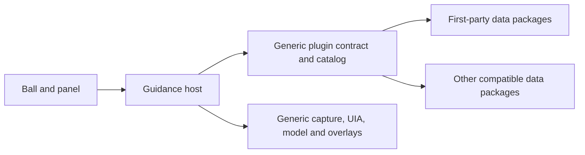

# Selected-Window Guidance: Implementation Specification

Updated: 2026-10-27

## Authority and Current Increment

`需求文档.md` v1.5 is the sole product and acceptance authority. This specification describes FR-01/02/03/04/08/09, PV-4/5/8 and the EXT-01–04 plugin migration; it does not replace the full support list or its criteria.

Windows Update has historical human evidence. Edge Downloads has human evidence for clarification, Chinese input, a control marker, state explanation, retention and cancellation. Activation on release has normal-path and cloud-off human/log confirmation after correcting asynchronous foreground completion; genuine OS refusal remains unverified. Other support-list tasks, visual-region fallback, document execution, snapshots, and rollback remain incomplete. TC-2 and TC-3 still govern their associated requirements.

## Architecture

### Active Increment: Bounded Observation and Stage Deadline

Acceptance for the v1.3 timeout/cancellation clauses (section 7.1, section 11.1, AC-8/14): activation, observation, model response and final revalidation share one 15-second processing budget; clarification starts a new budget on submission. A completed result must survive expiration of its former processing budget. Cancellation rejects late completions and prevents subsequent reads/requests. Native UIA/PrintWindow work runs in one short-lived, headless child at a time, using bounded in-memory pipes; cancellation terminates and reaps that child before admitting another. A worker watchdog bounds orphan lifetime. No desktop fallback, content files or worker network requests are added.

Verify with generated data and headless child fixtures: cumulative budget exhaustion, an operation ignoring cancellation, cancellation before dispatch, blocked-worker termination followed by a successful new worker, malformed/oversized output, and observation serialization. These checks do not establish native capture freshness, real desktop behavior, 3000ms performance or the Release resource budget. Desktop regressions require separate user consent.

- `BallWindow`: non-activating selection ball, edge clamping, target outline, event-driven tracking and cancellation.
- `GuidePanel`: disclosure, human cloud consent/revocation, plain-text response, transient single-line clarification, clear and exit.
- `GuideObservation`: target boundary, non-elevated foreground validation, UIA collection and full-context revalidation.
- `Capture`: target-only `PrintWindow` capture in memory. No desktop-region fallback or saved screenshots.
- `GuideModel`: bounded HTTP client, strict response parsing, request version/consent/clarification gate.
- `GuideSession`: serialized observation, cancellation, model requests, validated markers and clarification follow-up.
- `GuideDeadline`: one processing-stage budget, distinct from the retained session lifetime.
- `ObservationWorker`: headless MTA collection process, bounded memory-only pipes, serialized admission and termination/reaping on cancellation. It starts no WPF application, creates no window and receives no model key. The parent kills only its own collector, never the target application or provider process. Each child has a 15-second watchdog for orphan containment; idle has no worker.
- `OverlayWindow` and `Native`: click-through outlines and necessary Windows APIs. No global Esc registration or input injection API is retained.
- `CetaFae.Checks`: non-desktop contract/failure checks and explicitly launched generated desktop fixtures.

The collector admits only non-elevated targets matched by the session's enabled plugin. The shipped catalog contains Settings and Edge; adding another data package requires no host application branch. A target match is not acceptance of every page in that application.

### Extension Architecture Decision (2026-10-27)

The user clarified that every concrete application capability, including first-party features, must be a plugin. Adopt a software-independent guidance host with a common declarative plugin contract. Preinstallation grants no special API or policy bypass. This increment migrates the two existing application rules; public installation management, executable plugins and a stable external SDK remain separate work. Existing desktop acceptance does not automatically transfer to the refactored candidate.

| Boundary | Owner | Source and contract |
|---|---|---|
| Selection, focus, consent, disclosure and UI | Host | `BallWindow`, `GuidePanel`, `Native`; adapters cannot activate windows or draw overlays themselves |
| Session, request version, deadlines and cleanup | Host | `GuideSession`, `GuideDeadline`; all adapters use this lifecycle |
| Target-only collection and sensitive-content policy | Host | `GuideObservation`, `ObservationWorker`, `Capture`; bounded UIA control/raw traversal are generic mechanisms, selected through plugin data |
| Application identity, traversal selection and task semantics | Plugin | `plugins/<id>/plugin.json`; first-party Settings/Edge use exactly this contract, with no application-name or task-text branches in the host |
| Plugin contract, validation, enabled catalog and resolution | Generic plugin runtime | `src/CetaFae.Plugins`; .NET 8 without WPF, native APIs, model transport or application-specific rules |
| Model transport and response validation | Host | `GuideModel`; task knowledge may supply bounded context, never replace host policy or the selected recipient |

Current flow: deliberate drop → host consent/target checks → resolve one enabled plugin from target metadata → host collection using its traversal configuration → host model request with the explicit intent → fresh-context and plugin task-rule checks → host rendering. Task-rule results do not grant authority. No reliable match or multiple equally valid matches fails visibly rather than silently selecting by load order. Installing a package never adds its tasks to the published support list automatically.

#### Internal Contract v1: Declarative Application/Task Plugins

Start with data, not arbitrary executable plugins. `plugins/catalog.json` explicitly lists enabled package IDs; it is a developer-controlled deployment list, not a user-facing installation manager. Each enabled ID maps to its own `plugin.json`. IDs cannot contain path separators or traversal, package/catalog files and directories cannot be reparse points, files/counts/depth are bounded, and unknown fields or incompatible contract versions fail closed. Missing or invalid catalogs stop startup; no hardcoded application fallback exists. Catalog changes take effect on restart; future live disable must cancel affected sessions before activation of a new catalog.

- Data contract: `schemaVersion` (exactly 1), `id`, `version`, `displayName`, `targets` (each has `processNames` and optional exact `windowTitles`), `uiaView` (`control` or `raw`), `taskIds`, and `blockedPoints` (each has `intentContainsAny` and `candidateNameContainsAny`). The only current capabilities are explanation/question/guidance. No commands, URLs, DLLs, expressions or additional permissions are accepted. The schema version is the current compatibility gate; host-version ranges and app-version/language release metadata must be added before public installation rather than pretending an unbounded match establishes compatibility.
- `GuidePlugin` is an immutable validated definition. `PluginCatalog.Resolve(processName, title)` selects exactly one enabled plugin using target metadata; `Get(id)` retrieves that session-bound definition. No match throws `unsupported_target`; overlaps throw `plugin_conflict` rather than selecting by order. Duplicate IDs, malformed data and unknown schema versions reject the catalog. Removing an entry disables its package at the next startup; an empty list supports no application.
- Task rules initially preserve the existing pause-versus-resume exclusion as declarative blocked intent/name pairs in the Settings plugin only. The Edge plugin selects raw traversal. `AllowsPoint(intent, candidateName)` evaluates this common rule syntax; application/task words occur only in package data. More expressive selectors and task knowledge are deferred until a real task requires them. Task IDs describe the current pilot contributions, not proof of support for all pages in an application.
- Task knowledge is bounded plain data. It cannot replace system policy, bypass sensitive-field exclusion or request tool/command execution. Host validation remains necessary even for a signed or locally reviewed package.
- Declarative plugins receive no executable callbacks, live UIA objects, handles, images or credentials. The host applies their validated target and task rules to its authorized observation. Screenshots and model calls remain host-owned under existing privacy requirements, whose remaining gaps still apply. Future executable protocols must use minimized DTOs, never WPF/native/provider objects or credentials.
- Model output uses the existing `GuideAnswer` meaning: `ask`, `explain`, or `point` with an observed candidate ID. Declarative plugins supply constraints, not executable result callbacks. The host binds the result to request version/target/context, checks plugin task rules and revalidates before display. Unknown IDs, conflicting instructions or stale results are withheld. The contract does not grant native handles or execution rights to a package. Full task-scope publication remains subject to the existing acceptance gaps.

#### Implementation Sequence and Release Gates

1. Migrate existing application matching, traversal choices and semantic guards into two preinstalled packages. Keep existing generic lifecycle/native code and move shared plugin validation/resolution into one small UI-independent module. The host consumes a catalog, not a named Settings/Edge plugin. Startup owns the loaded catalog snapshot. Worker requests carry the selected validated plugin definition; workers check the real target against it and return the bound plugin ID. Subsequent observation/revalidation uses the same definition, not a fresh catalog lookup from disk or a plugin's chosen HWND.
2. Verify two first-party packages through this common route and add a generated third application plugin without editing host code. Check unknown/disabled targets, ambiguous matches, malformed/oversized data, incompatible versions, duplicate IDs, forbidden fields and preservation of the application-specific guard. Run existing locale, lifetime, IPC, model, consent and context regressions. These are headless engineering checks. Native focus, image freshness, interaction, retention and original performance/resource gates require separate evidence on the new build.
3. Before public installation, add user-facing review/enable/disable/remove, affected-session cancellation for live changes, version/language release metadata, contribution examples and public schema documentation. Freeze the public schema only after actual adapters and their real target cases pass. A package update cannot run new capabilities silently. Bundled data loading alone does not establish plugin installation safety or complete support-list acceptance.
4. Executable adapters are a later, separately specified capability. Do not load untrusted DLLs into the WPF host. Ordinary same-user child processes and `AssemblyLoadContext` are not security sandboxes. Establish and test OS-enforced file/network/process restrictions before opening executable third-party extensions; until then, accept data-only packs or reviewed built-in contributions. Keep future document transactions behind explicit write consent and TC-3.

The existing collector is a reliability boundary for trusted product code, not a general third-party plugin host. Microsoft explicitly warns that untrusted code cannot safely be loaded into a trusted .NET process; [the official plugin tutorial](https://learn.microsoft.com/en-us/dotnet/core/tutorials/creating-app-with-plugin-support) describes assembly dependency loading, not permission isolation.

Completion for this increment: two first-party capabilities are separate packages; the host has no concrete application or task special cases; the shared data-only contract works for a generated third application, rejects ambiguity and grants no new authority; existing non-desktop regressions pass. Desktop acceptance and public contribution readiness remain separately recorded in `验证记录.md`. A marketplace, automatic updates, third-party model providers and arbitrary workflow execution remain deferred.

## Observation and Response Contract

1. Idle performs no capture, UIA polling, or model request. Only a human-consented drop starts observation.
2. Bind to the selected foreground HWND/process/frame. Reject unsupported or unavailable targets before reading content.
3. The selected plugin chooses generic filtered-control or raw UIA traversal. Raw traversal is bounded to 4096 nodes, depth 48 and 128 candidates. The first-party packages select control traversal for Settings and raw traversal for Edge; the host has no corresponding software branch. Exceeding a bound fails visibly instead of returning partial success.
4. Collect visible, enabled, named interactive controls, runtime identity, type, rectangle and ToggleState when available. Unknown stays unknown. Exclude ScrollBar descendants by ancestry; transient scroll chrome must not impersonate page changes.
5. Capture only the target. Reject black/empty, closed, minimized and oversized captures. Non-black pixels alone do not establish freshness.
6. Send the task, candidates and optional PNG. Treat all screen/model content as untrusted data. The model has no execution tools.
7. Require exactly `mode`, `explanation`, `candidateId`. Modes are `point`, `explain`, `ask`. Only `point` may reference an existing integer candidate ID; others require null. Reject extra fields, arbitrary coordinates, malformed/truncated/oversized responses, refusal and unknown IDs.
8. Re-read the complete candidate snapshot before displaying any answer. Identity, name, automation ID, type, state, bounds and membership must match. Recheck HWND/process/frame/foreground. Reject stale explanations as well as markers.
9. Draw only a validated rectangle. New drag, genuine context change, target destruction, unrelated foreground activation, cloud revocation, clear or exit invalidates the request and clears both outlines. Late work cannot overwrite a newer version.

Events trigger comparison; they are not proof of a page change. Coalesce bursts and serialize provider reads. The parent kills and reaps a cancelled collector before admitting the next one, rather than abandoning a Task that still holds a native call. A stuck provider in another application is not terminated. Worker IPC limits output to 12Mi characters and errors to 4096 characters; input is bounded to six times the 32KiB package limit plus 4096 characters to allow JSON escaping and the target envelope. Malformed/oversized output is never treated as a successful observation. Collector diagnostics are suppressed in the child; the parent records counts/bytes and aggregate observation duration, without content.

## Clarification and Focus

Activation on release (2026-10-27 user decision, requirements v1.2): with cloud enabled, a deliberate drop may activate the selected target once before observation. The existing Windows `SetForegroundWindow` API is sufficient; no input injection, forced activation workaround or background retry is added. Reject unavailable, unsupported or elevated targets before requesting activation. Already-foreground targets skip activation. Cloud-off and preview paths never activate a target. The product's own ball/panel remain non-activating except for deliberate question-field input.

Cross-process activation can complete asynchronously: an accepted call can briefly leave foreground HWND zero. After one activation attempt, confirm the foreground transition with a cancellation-aware wait bounded by a 500ms deadline (25ms intervals); this reads HWND metadata only and is scoped to the user's request, not idle screen polling. During this wait, tolerate the original foreground or zero, but cancel on an unrelated new foreground. Clear the exception when the request ends; an old request cannot clear a newer request's activation state. Never issue another activation call from this wait.

If the deadline expires without confirmation, stop before UIA, capture or a model request and give an actionable click-target instruction. Activation failure clears tracking and outlines. Log only the fixed event/reason and HWND metadata. A real foreground transition can still invalidate the session later; do not remove post-model context checks. See [Windows activation limits](https://learn.microsoft.com/en-us/windows/win32/api/winuser/nf-winuser-setforegroundwindow) and [Microsoft's asynchronous activation explanation](https://devblogs.microsoft.com/oldnewthing/20161118-00/?p=94745).

Verification: local message/privacy regressions and the existing suite; manual drop from this chat into a visible inactive Edge window without clicking Edge first, checking target activation and recognition. Then confirm a later deliberate switch away cancels normally and cloud-off drops do not activate. OS refusal and administrator-target behavior require separate evidence and are not covered by a successful normal drop.

A drop does not require typing first. With no stated goal, an uncertain settings task produces a short explanation/question. A local gate prevents speculative initial control markers.

Initial-clarification correction: the initial task must describe only the selected visible page and ask one short question about it. Engineering coverage lists and unrelated application examples are not user intent and must not be included in the task. Verify with a generated Edge Downloads page before repeating E-06 manually; generated success does not replace desktop acceptance.

An `ask` result shows one single-line field without focusing it. Only a deliberate user click activates that field. While its question is current, deliberate input may retain the session; unrelated foreground activation cancels it. Do not start another target observation while the input panel is foreground. Cancelling a read terminates its collector process, not the external application's provider.

The answer is plain text, at most 300 characters, consumed once for that target/version. Submission clears/hides the field, returns interaction to the selected target through the same 500ms activation confirmation used on drop, validates the old context and takes a fresh target-only observation. Activation and reads share the new submission-stage budget. A changed, closed or unavailable target cannot reuse the answer. Cancellation, new drag, revocation and exit discard the question. Never log input content.

The uncertain-settings path now asks for intent, unlike the old fixed Windows Update task. Historical zero-input results do not establish acceptance of this interaction. The v1.3 Release candidate has human evidence for a Downloads-only initial question, Chinese input/submission, explicit field collapse and a marker on the requested enabled save-location switch with a matching explanation. The confirmed 30-second unchanged-result observation is supported by about 76.61 seconds before switching away in logs. The candidate's clear button also has human confirmation for removing both frames, retaining ball/panel and no old result returning over 30 seconds. Exact 500ms visual cleanup, candidate revocation observations, precise geometry and full foreground behavior remain open. Initial/follow-up processing exceeded 3000ms; see the verification record.

## Configuration and Data

- .NET 8 / WPF and platform libraries only; the small data-only plugin runtime adds no external package. Follow the extension boundaries above for all application-specific behavior.
- Selected model: `deepseek-v4.1-flash`, via the user's opencode Go channel at `http://127.0.0.1:8787/v1`.
- `POST {baseUrl}/chat/completions`, non-streaming JSON-object response. PNG uses an `image_url` data URL. Explicit text-only mode is diagnostic and does not establish image acceptance.
- Optional `CETAFAE_API_KEY` comes from the process environment. Never inspect credential files or log key values.
- Remote endpoints require HTTPS; HTTP permits explicit loopback hosts only. Disable redirects and system HTTP proxies in the client. This does not establish the Go channel's upstream routing.
- Disclosure states sent data, receiver, refusal and uncertain upstream retention. PV-7 is not fully accepted while retention remains unverified.
- Images, UIA text and answers stay in memory. Retained context excludes PNG bytes. Logs contain event codes, counts, geometry, timing and error categories only.
- Build output, intermediates and diagnostic logs belong under ignored `.artifacts/`.

## Verification Gates

Clarification crash regression (2026-10-27): the application runtime must support Chinese Windows locale 2052 and WPF's current input-language lookup. Invariant globalization caused an unhandled CultureNotFoundException when the answer field received focus. Reproduce with the application's generated runtime configuration before fixing it, then pass the locale checks under that same application configuration. Restore normal globalization; do not suppress the exception or disable the user's input method. Human focus/typing/submission remains a separate acceptance step.

The application now explicitly sets `InvariantGlobalization=false`. The console check runner initializes its dispatcher without creating a window before querying WPF's input language. At the globalization-fix checkpoint, both runtime configurations passed the same 75 checks; the subsequent activation checkpoint passed 82. These historical results do not establish v1.3 acceptance. See [Microsoft globalization configuration](https://learn.microsoft.com/en-us/dotnet/core/runtime-config/globalization) and [WPF input-language implementation](https://github.com/dotnet/wpf/blob/main/src/Microsoft.DotNet.Wpf/src/PresentationCore/System/Windows/Input/InputLanguageManager.cs).

Commands are in README.md. Store actual results in `验证记录.md`; do not create per-attempt reports or parallel acceptance plans.

Local checks cover parsing, endpoint restrictions, context validation, consent/version cancellation, clarification lifecycle, HTTP payloads and representative failures. Real-model checks use generated images/data only and do not establish real-page readability.

Desktop checks require separate user permission and human in-product cloud consent. Inspect fixed-data preview first, then actual Edge Downloads without changing settings. Verify candidate/state readability, initial explanation/question, deliberate answer input, precise marker after an explicit goal, unchanged-page retention, navigation cancellation, focus and clear/revocation/close cleanup. Regress Windows Update separately.

Requirements v1.3 retains 3000ms processing gates and defines initial/post-clarification clocks, cancellation deadlines and resource measurement. The user deferred latency optimization, not acceptance; do not reclassify old samples using the revised contract. Full support-list coverage and Windows 10 behavior remain unverified. The exercised Debug process exceeded the idle memory budget in a short sample; this is not a Release baseline or evidence that the budget is impossible. See the verification record.

Official API references: [TreeWalker.GetFirstChild](https://learn.microsoft.com/en-us/dotnet/api/system.windows.automation.treewalker.getfirstchild?view=windowsdesktop-10.0), [UIA threading](https://learn.microsoft.com/en-us/windows/win32/winauto/uiauto-threading) (collector uses a windowless MTA thread), [redirected process output](https://learn.microsoft.com/en-us/dotnet/api/system.diagnostics.processstartinfo.redirectstandardoutput?view=net-8.0) (both output streams are drained concurrently).

## Requirements Review Resolution (2026-10-27)

After reviewing v1.2, the user explicitly delegated the best correction. The adopted contract is requirements v1.3, not this specification. All 19 task directions remain, with S/W/E/D task identifiers, bounded starting states/goals and conditional capability publication. Windows 10 compatibility is declared separately from Windows 11 Settings tasks. Further implementation was not performed in this document revision.

The correction resolves explanation/marker conflicts by withholding guidance, makes Esc local to product focus with an always-accessible clear control, separates necessary clarification from machine processing time, and differentiates successful restoration from safe refusal/failure. No evidence means no region marker. Conditional TC gates now propagate to dependent AC clauses and the release list. The 3000ms thresholds remain; historical failures remain failures under their original contract.

NFR-06 uses Release total product-process Private Bytes <=90,000,000 and machine-normalized CPU <=0.3%, in two ten-minute idle samples before/after use. Working set is a separate diagnostic. The hardware reference was read on 2026-10-27; no performance outcome is implied. Resource and timing protocols are specified only in requirements section 11 to avoid competing definitions here.

### Implementation and Acceptance Gaps After Revision

- The current exercised increment covers parts of Windows Update and Edge Downloads; it does not implement or accept all 19 tasks or the newly explicit fixture/state matrix. Keep historical human, generated-fixture and model evidence distinct. Freeze the actual v1.3 cases in the existing verification record before acceptance runs.
- The current increment implements a shared processing deadline and native-read process isolation. Headless fixtures cover blocked-worker termination/recovery and an HTTP handler ignoring cancellation; this is not real-desktop acceptance. The 500ms full cancellation/navigation bounds, 30-second stability/cancellation observations, real UIA identity across collectors and the v1.3 15-second desktop boundary still require targeted verification. Process startup/revalidation overhead must be included in actual timings.
- Current capture is selected-window PrintWindow only. Graphics Capture fallback, its Windows 10 1809 picker path/target binding, and sensitive-field exclusion/minimum-region policy remain implementation gaps. A selected-window capture is not automatically data-minimized or fresh. See [PrintWindow](https://learn.microsoft.com/en-us/windows/win32/api/winuser/nf-winuser-printwindow), [CreateForWindow](https://learn.microsoft.com/en-us/windows/win32/api/windows.graphics.capture.interop/nf-windows-graphics-capture-interop-igraphicscaptureiteminterop-createforwindow) and [capture selection](https://learn.microsoft.com/en-us/windows/apps/develop/media-authoring-processing/screen-capture).
- Production data/metadata retention and verified proxy/provider disclosures are not accepted. Current developer diagnostics do not establish the required automatic retention policy. Cloud-off and revocation human/log evidence cover exercised paths; they do not establish all new consent-change and request-boundary cases.
- D-01 execution, preview/confirmation, safe commit, snapshots, recovery, quota and expiry behavior remain unimplemented and gated by TC-3. A correct local .docx transformation alone is insufficient. Cloud consent and write consent are independent.
- Release timing and both resource sampling rounds have not been performed. Existing Debug short samples and runtime-counter sessions remain diagnostic failures/limitations, not the new acceptance baseline. Check timing instrumentation against the release/answer-submit origins before measuring.

Resume implementation against the authoritative task IDs and relevant acceptance clauses when requested. Preserve old plan/measurement history; do not silently replace an already-started plan's gates with new definitions to make it pass.
