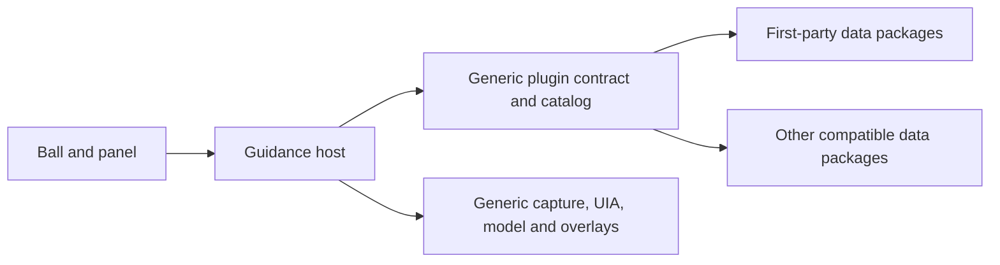

# Selected-Window Guidance: Implementation Specification

Updated: 2026-11-01

## Plain-language window recognition (approved2026-11-01)

Preview.24 separates a headers-wait timeout from a successful result whose post-layout reader viewport is zero. Reproduce the production panel's measured HWND-size/arrangement cycle, not only a standalone card always given320DIP. Exercise processing to a long result with reference and region actions, repeated reuse, and footer wrapping. A noncollapsed session must retain readable text and reachable actions inside its actual bounded host; compact intentional collapse remains valid. Fix the sizing dependency rather than forcing repaint or inventing fallback text. Preserve the independent headers-wait failure and the unchanged privacy/deadline/model contract.

The reproduced dependency is ScrollViewer's deferred extent update: synchronous presentation measurement can size the host from an old zero body demand, and an ordinary later measurement restores it. Preserve immediate positioning, then coalesce one `DispatcherPriority.Loaded` remeasurement after normal layout; later state changes use the latest content, and closed windows skip queued work. Do not force a paint or add a guessed fixed reader height. Headless measured-host tests must also fail with this callback removed, including normal dispatcher pumping, before accepting the repair locally.

Native preview.22 ordinary-window feedback exposed one model-stage timeout and one visible reader with no text despite a completed structured result. Preserve both as failures, not ordinary-window acceptance. Reproduce reused long/scrolled-reader transitions offscreen, including timeout notice to a fresh recognition result. A new result starts at the beginning of its text. Add bounded presentation metadata after layout (text presence/visibility/viewport and card state only, never text, questions, pixels or credentials) so native display failure can be separated from a missing model answer. Do not raise the processing deadline, automatically retry, or bypass context/privacy checks to mask either failure. The caret-driven context-check frequency is an observed separate issue, not evidence of the blank-reader cause.

Extend the independent identification response with required `kind`: `regular`, `attention`, or `uncertain`. This is generic visual presentation, not application matching or a health/authenticity verdict. `attention` requires a readable actual error/warning interface, never a quoted message in a document, a normal paused setting or a hidden inferred failure. A missing purpose cannot support a known kind. Keep application/page independent, null when unsupported. Return one Chinese context question for attention, or one goal question for ordinary/uncertain windows; no command, repair or marker.

Main feedback uses a short state headline, plain visible description and one next step. Never concatenate process ownership, file metadata, signatures or package identifiers into processing/success/failure presentation. Validate PID/start binding exactly as before; raw ownership stays internal and never enters model payloads. A clean local product label may support an explicitly self-reported name when vision is unavailable, without claiming authenticity or software health. Reading/privacy/model failures remain distinct from the selected software displaying an error. Reuse the attached reader/input rather than adding a modal, new collection or a second request. Safe failure messages avoid provider text and technical terms, retain conservative refusal and cancellation.

Acceptance: strict shape/kind and missing-evidence rejection; ordinary/error/warning/unknown/quoted-error/paused generated cases; independently known software/purpose; processing/success/service fallback without raw ownership; sensitive, permission, capture and network messages with one understandable recovery action. Preserve late-result/privacy guards. Review production offscreen normal/narrow cards, then one later consolidated native batch, not repeated permission flows.

Preview.23 native attempts timed out in Model after roughly1second collection and14seconds waiting, with processing/timeout layout booleans true but no completed result. Before another user attempt, run one generated-document service probe using the unchanged identification prompt, a generated1456×962 image and20 generated controls, the production15second model limit, no native collector, and headers-wait timing/status only. A timeout without desktop work supports a service-path bottleneck; a success does not clear native collection/display failures. Stop after that one request and retain its outcome; no automatic retries or production deadline change.

The generated probe returned in4572ms; the native timeout cause remains unresolved. Add fixed `guide_model_transport` metadata at send, headers, complete body and terminal outcome. Correlate each request by a generated identifier; record elapsed time, numeric HTTP status and current headers/body/envelope-validation stage only. Never include receiver, headers, request/response text, pixels, credentials or exception details. Envelope completion is not identification parsing, semantic correctness or visible rendering. Preserve cancellation, response limits, one-request behavior and the shared deadline. Verify success, cancellation before headers/during body and HTTP failure with controlled handlers before packaging a diagnostic candidate; current running binaries remain unchanged until separately authorized replacement.

## Installation agreement (approved2026-11-01, supersedes first-start onboarding)

The user-supplied root `jingxi.ico` is the single application/installer/tray icon source. Reference it through MSBuild `ApplicationIcon`, an embedded `CetaFae.jingxi.ico` resource and Inno Setup `SetupIconFile`; installed shortcuts and uninstall display continue to use the application executable. The tray clones the embedded icon and releases its stream, avoiding a separate rendered whale/water icon and working without loose files in a single-file bundle. Verify icon resources in the actual published EXE and compiled setup without launching the visible application or installer. This change does not alter runtime consent or guidance.

The self-contained package includes the Windows Desktop runtime and native dependencies; installation requires no separate .NET download, global runtime installation, environment-variable changes or elevation. Verify the actual bundled headless worker with all .NET runtime search paths pointed at an empty generated directory, then send only a generated null request and require the normal invalid-request reply. This proves bundled managed/native startup without target reads or profile/consent access, not clean-machine installer acceptance, model-service provisioning or support for older Windows releases.

Use a standard per-user Inno Setup installer rather than a custom installer framework. Ship a self-contained Windows x64 build, install into LocalAppData/Programs/CetaFae with Start menu/uninstall entries and no elevation/autostart. The first installer page displays a concise usage agreement plus the exact disclosure for existing validated non-secret preferences (defaults on a fresh machine). Its sole affirmative action is Agree and install. Reject silent installs; cancellation and installation failure do not create consent. No first-start or settings affirmative cloud action remains. Settings retains read-only disclosure and withdrawal. Invalid/changed/revoked consent fails closed and directs deliberate recovery through the installer.

Before copying files, a headless app helper exports agreement text and its SHA256 scope; it neither opens WPF nor loads plugins, logs, captures or sends requests. After the visible decision and successful file installation, the installer supplies that exact scope to a headless completion helper. The helper revalidates current preferences and atomically saves the existing current-user DPAPI grant only if scope still matches. This local command is an installer handoff, not a security boundary against a process already running as the same user; window/model text has no execution path to it. Scope mismatch, invalid configuration or write failure prevents automatic product launch. No actual user-profile grant is changed by development tests.

Acceptance: generated isolated tests cover missing/malformed/stale receipts, invalid configuration, changed receiver/model/image/terms, persistence failures and same-scope restoration. Compile installer and self-contained package, inspect production disclosure/settings offscreen, then run one consolidated native install/cancel/restart/uninstall batch only after separate desktop consent. Preserve current preview.20; accepted notice×/fullscreen cases are not repeated. Hosted model delivery, code signing and ordinary-user distribution remain separate gates.

## Transient notices and fullscreen idle presence (approved2026-11-01)

Reuse the production card with a distinct notice view for statuses without a bound target. Give notices a header close action and no collapse/clear footer; closing only resets/hides this presentation and never changes consent or cancels another session. Keep explicit consent/reference confirmation and active guidance unchanged. While a notice is visible, sample only physical mouse-button down state and pointer position to dismiss on a new press outside its own native bounds, without intercepting input, recording click coordinates or installing a global hook. Stop sampling on hide/reset. Use the high bit of GetAsyncKeyState; its historical low bit is unreliable ([Microsoft documentation](https://learn.microsoft.com/en-us/windows/win32/api/winuser/nf-winuser-getasynckeystate)).

At500ms idle intervals, compare only the foreground window's frame/client geometry with its monitor. Both must cover the monitor; this excludes ordinary maximized windows whose client area retains title chrome. Ignore shell desktop windows, our own process, invalid/minimized windows and windows on a different monitor. Hide only the idle whale, stop its decorative animation and dismiss any transient notice; retain tray/settings access and restore without activation after fullscreen ends. A bound session or drag is exempt. No screenshots, content reads, model requests, new packages or per-application rules. Invalid geometry leaves the whale visible. This is geometry-based fullscreen detection, not an exhaustive claim for every exclusive-mode game.

The authorized2026-11-01 game diagnosis reproduces a missed fullscreen case: all20 samples have client/monitor bounds0,0,3440,1440 but DWM frame-1,-31,3441,1441. The frame encloses the monitor instead of matching its edges. Require the client to match the monitor within the existing1px tolerance, while allowing the frame to enclose the monitor with the same tolerance for inward rounding. Do not enlarge the client tolerance, infer fullscreen from frame size alone, add application-name rules or change monitor/session/drag exclusions. Acceptance: the observed overscan and its negative-coordinate translation pass; clipped frames, title-bearing maximization, oversized clients and existing invalid/different-monitor cases refuse. Run both headless configurations and package a candidate; runtime hide/restore still needs separately authorized replacement and focused evidence.

Tasks/acceptance: reproduce the notice footer regression; check notice close/consent preservation and session transitions; check fullscreen/maximized/negative-coordinate/borderless/invalid geometry plus active-session/drag exemptions; implement with existing controls/native APIs; inspect actual production card offscreen at normal/narrow widths; run both configurations and package one candidate. Native outside-click/fullscreen/restore and real focus/timing remain for one separately authorized combined batch; leave preview.19 running during implementation.

## One-time onboarding consent (approved2026-11-01)

Goal: remove routine cloud toggles while preserving a single personal first-use decision, automatic same-configuration reuse, settings-only withdrawal and the existing selected-window privacy boundary. The current unpacked preview has no installer: show the existing disclosure card once on startup when consent is missing/invalid; its primary action is "同意并开始使用". Later installation may integrate this into "同意并安装", but no installer or legal-agreement delivery is claimed here. A rejected/withdrawn drop only shows a status directing the user to Settings, without repeated disclosure, activation, content reads or requests. Withdraw by deleting the saved grant (fall back to a protected disabled record if deletion fails); if neither persistence operation succeeds, keep this process disabled and disclose failure. Do not silently upgrade legacy disabled records into permission. Configuration changes and corrupt preferences retain the existing safe reset behavior. Keep the running preview.18 until replacement consent.

Implementation plan, using the existing WPF controls and protected store:
- [x] Update requirements and current README/Test-Plan instructions; preserve historical switch tests as evidence for their original builds.
- [x] Observe failing checks for the missing store-revocation API and the stale hidden affirmative callback after declining; cover the toggle-free shared menu, affirmative event, settings labels and saved-grant removal.
- [x] Simplify GuideMenu; replace GuideSession's toggle with separate accept/withdraw operations, reuse CloudConsentStore, show missing-consent onboarding once through the startup dispatcher. Keep owned-request cancellation and new-consent requirements.
- [x] Reuse the production card/settings layout for new copy; retain complete receiver/scope/retention disclosure and a rejection action. Debug/Release each1168 checks pass; normal/narrow production views inspected offscreen. No desktop launch or real consent operation during development.
- [x] Package preview.19 separately with checked Release module db98dfb8037c4ec08de501e79f186708; source/evidence synchronization is recorded with the Git commit.
- [ ] Native first use, restart, withdrawal in flight, settings and affected follow-up cases require one newly approved consolidated batch; local checks cannot accept these or timing/resources. Store checks cover grant removal and honest locked-file failure, but not the deletion-fails/disabled-tombstone-succeeds branch. Startup dispatcher and full session wiring remain native acceptance gaps.

## Attached feedback (2026-11-01, native candidate)

The user approved combining the two demonstrated surfaces. Reuse the existing bounded, non-activating GuidePanel HWND: ordinary feedback attaches below the existing input shell; a validated and actually visible control marker may instead show a compact droplet bubble beside that control. Expanding details replaces that bubble with the attached full reading surface. Collapse keeps the session and marker, with an attached reopen tab; the existing shell close and clear actions end the session. Management remains exclusively in tray/right-click. Keep full explanations available without another model request or invented summary. Long text scrolls above fixed actions. Failed recognition and privacy refusal attach to the returning whale without retaining target content or marks. Consent remains explicit and separate from ordinary feedback. Preserve preview.13 art, input dimensions, capture scope, transport and cancellation gates.

Implementation tasks: add generated checks for collapse/details/reset, consent guards and placement around the input/control/work-area; implement the two presentations using the same native card and handle; connect only validated marker results to the bubble; render actual WPF normal/top/long/error states offscreen and inspect them; run both configurations, package preview.14 and synchronize source. Native replacement is permission-bound. Acceptance includes no duplicate reading surface, no control/input overlap for bubbles, readable long text and reachable actions, no automatic focus, no stale content after cancellation/revocation, and unchanged guidance/privacy behavior. Headless checks do not close native focus, visual, 3000ms or90MB gates.

Design provenance: the isolated fixed-data study under ignored.artifacts/feedback-study/ demonstrated both surfaces and passed14browser checks. The subsequent user approval authorizes their combined native implementation; that earlier HTML result itself remains preview evidence, not native or performance acceptance. Use existing #258FEC water blue, #F8FCFF reading surface, #143747 ink and Microsoft YaHei UI; preserve input/send/close geometry.

## Remembered consent and unified management (2026-10-31)

Goal: eliminate the whale left-click management popup and repeated startup consent, while retaining explicit first-use consent and revocation. The delivered art is now integrated in the same candidate for one consolidated native trial.

Design: use one WPF context-menu instance from both the whale right button and the Windows tray icon. Keep the attached session input and existing on-demand explanation card. Left click has no management action. Use the installed Windows Desktop framework's NotifyIcon, without adding a package or a second menu implementation. Dispose the tray icon on application exit. A menu-open exception to foreground validation applies only to our own menu/owner handles.

Persist only a DPAPI CurrentUser-protected versioned record containing a hash of the exact disclosure and the enabled flag, under LocalApplicationData/CetaFae/consent.dat. The hash includes recipient, model, image scope and terms; changed disclosure, missing/corrupt/oversized or inaccessible storage fails closed. Do not persist API keys, window identity, captures, user text or model results. Store on explicit consent and subsequent switch changes using atomic replacement. When storage fails, report a fixed error, do not silently promise persistence; revocation still cancels immediately in memory. Plain restart never calls collection or transport. Public-reference query consent remains per query and is never restored.

Implementation plan (inline execution):
- [x] Add checks for remembered on/off state, changed scope, malformed/tampered/oversized records and failed storage; observe failure before consent-store implementation.
- [x] Implement the consent store and connect restoration/revocation to GuideSession without changing its request gates.
- [x] Route right click and the tray to one menu; remove the left-click popup, preserve drag/input/close and consent-card behavior.
- [x] Complete both non-desktop configurations and review generated disclosure/art states; native tray/restart acceptance remains separate.
- [ ] Update both READMEs and evidence, synchronize source; request one consolidated native trial only after the candidate is ready.

Acceptance: left click produces no management popup; first enabling requires the visible personal consent control; same-scope restarts restore on/off; changed scope or bad storage cannot enable; disabled drop cannot activate/read/send; tray and right click share commands; exit removes tray resources. Native menu placement, Explorer restart, real first-use/restart and revocation timing require consent-bound desktop verification. The original 3000ms/90MB gates remain open.

## Refined water integration (2026-11-01)

Latest scoped import: droplet-spout-v1 supersedes only the airborne ribbon layer. Reuse its exact four-cubic EPS-derived SVG, with3/3/2solid droplets emitted150ms apart on the existing trajectories. Normalize the supplied shape once, freeze it and rotate its rounded end along each local trajectory tangent; reuse the native vector renderer rather than shipping80new raster frames. Preserve whale/pool assets, fill/spread clocks, input, the accepted concurrent scan/perimeter fade and cancellation. Acceptance: separate droplets, source-aligned shape/position/orientation, no host-edge clipping in either facing, and unchanged normal/top transition endpoints. First observe a rendered separation check fail on ribbons, then implement, run both configurations and inspect decoded playback against the delivered spout at matching scale. Package and synchronize source; native replacement and visual acceptance remain permission-bound.

The user delivered the art and authorized import. Use spout-fill-v4 for the continuous receiving/fill path and window-wash-v1 for the advancing surf reference. Import the unchanged whale action into two96px-cell atlases (35frames), the384px resting-water source and its editable SVG, plus registered jet offsets. RefinedWater transcribes the delivered cubic trajectories: upward emission, outward expansion, fixed-horizontal descent, short0.30s ribbons. Receiving width grows over0.72–1.80s, fill begins only after first arrival1.045s, with opaque downward whale occlusion. Input replacement is complete at1.80s; the existing fast-result path can reveal native input earlier without losing user text. Keep idle/drag/return identity and their existing assets.

The subsequent finite strip uses an asymmetric curved leading edge, deeper blue below and a pale transparent trail above. The2026-11-01 user correction supersedes the former exit-before-border order: fade the complete four-edge perimeter from transparent to full opacity over the same1.24s downward scan, then hold it. Reuse the existing progress clock and bounded surfaces; do not gate edges by the moving wavefront or allocate another full-window layer. The strip remains bounded to192+26DIP maximum height. Retain existing pure-blue perimeter, corners, input geometry and cancellation/reduced-motion policy. Review runtime-generated ordinary/top playback and water-only/grid boards; art delivery and headless checks do not establish native acceptance or90MB/3000ms compliance.

Focused task: first change the production-render pixel check to require increasing perimeter alpha during the translucent scan and full opacity at scan exit; observe the old implementation fail. Change only the perimeter opacity timing, then run both full configurations, inspect generated playback and package the candidate. No repeat of accepted menu/Chinese guidance flows or the20-cycle resource test for this timing-only change; native visual acceptance remains separate.

## Whale art integration candidate (2026-10-31)

Next art refinement is planning-only (2026-10-31): the user accepts the exercised interaction rhythm but rejects the stretched low-resolution spray and rectangular sweep aesthetics. Art-Production-Brief.md owns the scoped asset handoff: redraw spray and belly-water layers, preserve whale identity, supply rise/surf reference keyframes. After asset inspection, remove placeholder spray stretching and use a bounded procedural wave with a darker lower advancing front and a lighter transparent upper tail, then reveal the existing seamless perimeter. Use a few broad curves and gradients, not a full-target texture or new rendering framework. Preserve native input, clipping, cancellation, reduced motion and resource gates. Do not code, replace the live candidate or package another version until the art is delivered and inspected; then consolidate integration and verification into one candidate. Existing preview.10 human timing/corner/smoothness evidence remains historical, not final art approval.

Preview.10 supersedes preview.9 timing and border reveal: hold the original water/whale pose for400ms while the larger spray opens, then retain the800ms rising-water morph. Scale only the existing spray around its blowhole pivot so mature spray exceeds whale-body width without clipping either dock orientation. Reuse the bounded192DIP traveling surface with a low-alpha blue sweep; keep the perimeter absent throughout the sweep, then fade it in over the last160ms of a1s coverage clock. Fix diagonal antialias gaps by overlapping each side's vector fill at the corners, while keeping the four native surfaces disjoint. Verify alpha, all corners, stitched surfaces and reduced motion/fast input/cleanup before any permission-bound live replacement. Do not infer native acceptance from the previous binary.

Preview.9 supersedes the prior side-expansion timing: spray, rise the existing water outline to occlude the constant-alpha whale, then sweep downward and retain the perimeter. Keep the800ms water/dialog morph; follow with a finite800ms traveling wash. Reuse the old downward wavefront but bound its transparent native surface to one192DIP moving strip; never allocate a full-target surface. Reveal the four existing edge strips behind its leading front. Show ready native input immediately even if a fast model result finishes the whale early; the independent finite wash cannot delay input. Reset cancels and shrinks all five surfaces. Generated playback and software timings are preliminary, not native acceptance.

Ending a bound session clears overlays first, then moves only the product whale along a600ms eased path to the current work-area bottom-right with an8DIP margin, faces left and plays the existing one-shot click/jump sequence. Drag-start and process exit skip this return. Reduced motion snaps home without the travel/jump; a new press interrupts travel. No focus/input/capture authority changes.

The user subsequently reduced the overall prompt width to80 percent:360→288DIP. Keep36DIP body height, text size and26DIP controls unchanged. Recheck256/288/320DIP layouts and render the actual288DIP host; do not uniformly scale text/actions.

Preview.8 compact dock geometry:36DIP visible blue body,26DIP left inset (previously18),26DIP persistent inline triangle and26DIP centered secondary close. Keep the existing88DIP transition host and76DIP exterior dock foot; ordinary body is y40..76. When exterior room is unavailable, the native body starts at y0 and only its shell is vertically mirrored; text/actions remain upright. A work-area-covering target uses horizontal work-area center, not the former40-percent target anchor. Refresh layout on target geometry events and preserve reset/cancel behavior. No app-name adaptation or desktop reads are added.

Public height references checked2026-10-31 (source/design values, not local application measurements):

| Reference | Logical height | Source |
| --- | --- | --- |
| Windows standard/tall title bar |32/48 |[Microsoft title bar design](https://learn.microsoft.com/en-us/windows/apps/design/basics/titlebar-design) |
| VS Code custom title bar |35 with command center,30 without |[window.ts](https://github.com/microsoft/vscode/blob/main/src/vs/platform/window/common/window.ts),[titlebarPart.ts](https://github.com/microsoft/vscode/blob/main/src/vs/workbench/browser/parts/titlebar/titlebarPart.ts) |
| Chromium horizontal tab strip |41 =34+1+6 |[layout_constants.cc](https://github.com/chromium/chromium/blob/main/chrome/browser/ui/layout_constants.cc) |

36DIP is an engineering compact compromise near common32–41 values, not a claim of exact title-bar matching across applications. CSS/WinUI logical values are compared with WPF DIP at100-percent scale; actual physical pixels vary with DPI, version, theme and touch mode. Edge/Office/WPS local heights were not measured. Do not branch on software identity just to size this generic prompt.

Follow-up preview.8: continuously morph the existing resting underbelly water silhouette into the native shell, rather than spawning a separate puddle. Sample only the embedded resting-water alpha contour once, interpolate that same outline toward the shared shell boundary, and retain constant-scale whale occlusion plus concurrent spray. No runtime external capture or new raster asset. Keep an always-visible blue triangle send action inside the white field; disable when blank/unavailable, retain Enter, and center a larger secondary close inside the blue shell. Verify source continuity, final native geometry and hit areas with generated data first. A full-window traveling wash is feasible as a separate finite strip, but this revision does not introduce that mechanism or claim its native cost measured.

Follow-up after preview.6's human trial: preserve the exercised smooth maximized perimeter architecture, shell drag and session close. Increase the nominal water depth from56 to96DIP, including16DIP of opaqueWhaleBlue before the80DIP fade; tiny targets scale the profile proportionally. This intentionally changes the former56DIP geometry/area fixture, not the90MB/3000ms acceptance gates. Draw only the expanded perimeter and remeasure generated software raster cost. Replace shrink/fade with a constant-scale downward whale, clipped by the emerging water surface: the shell grows upward/outward from its fixed dock foot, the whale descends as the shell rises, spray runs concurrently, and a white input silhouette resolves into the unchanged native prompt within the existing800ms bound. Reuse atlas cells and shared shell geometry, no image dependency, shader or new capture. Reduced motion jumps to native input; cancellation discards the entire transition. Inspect real native-rendered frames/playback with fixed targets before any new live replacement. Broader visual acceptance and formal resources remain open.

Maximized-render correction after preview.5 failed its native trial: preserve the soft inward glow, but allocate only four non-overlapping perimeter surfaces, not one full-target transparent surface. Reuse the existing nonactivating/click-through overlay window. Shared target coordinates and equivalent ripple timing keep corner continuity; hide/reset/close must stop every edge clock and shrink every surface. Replace24 per-frame boolean exclusions with four frozen gradient edge meshes and no geometry boolean operations. Bound edge width to56DIP and cap motion at15fps. Validate3440x1392/4K/DPI/tiny layouts, tiled-vs-composite pixels, cleanup and generated offscreen render time before requesting another desktop batch. This is a candidate cost reduction, not native smoothness or90MB acceptance. Preserve OS activation refusal and safe manual-region fallback; do not bypass either to pass the trial.

Attached prompt revision: the supplied drawing is a layout concept, not pixel dimensions or a final asset. Use a360DIP-wide,88DIP-high host surface with a64DIP prompt centered inside. Draw a native rounded blue shell with soft shoulder/foot curves; its bottom sits76DIP below the host top and touches the selected window top when exterior space exists. Maximized placement keeps the complete prompt/close hit area inside the work area. White native single-line input dominates; a32DIP circular send action lives inside the shell. A20DIP low-emphasis close hit target stays inside the shell at the right, separated from the primary32DIP send action; it has no external footprint. Use one shared shell geometry/theme brush for native layout and morph. There is no grip icon/button: drag the visible blue shell itself to reselect, or click it to open the existing menu. Native input/send/close intercept their own hit targets, never triggering shell drag. Close clears through the existing session cancellation path, never exits or changes the target; preserve once-only Chinese/IME submission, no automatic focus, and stale-response rejection. Inspect fixed-data waiting/question/typed/result states at320/360/420DIP and ordinary/maximized dock positions before wiring close and packaging the combined water-glow/blink/prompt candidate. No new images or dependencies.

Interaction revision after the first native trial: supersede the settling-first timeline with one 0.8-second drop transition. Reuse the settled source layers and early spout cells; one easing value drives the input morph and target wash from the first render. Start after consent/target/privilege/plugin checks but before asynchronous activation; activation failure still cancels everything before collection. Do not wait for the model or add requests. Keep the original exported timeline as art-source evidence, not the new runtime clock.

The later visual correction supersedes preview.3's outlined wave band and two-cycle pulse. Draw a target-clipped blue water glow fading inward across about 56 DIP, without a stroke or hard inner contour. Four gradient edge meshes replace nested boolean contours; the outermost opaque fill uses the sameWhaleBlue as the prompt, then fades toward a transparent inner ripple. The inner water ripple travels slowly on a four-second loop with at most15 presentation updates/second while the overlay is visible. Clamp depth for tiny windows and keep the content center transparent. Expand validated control frames by8DIP, clipped to target/work bounds; retain the4DIP contrast outline but blink between visible/hidden every0.6 seconds for the lifetime of the instruction. Reduced motion uses a static glow and fully visible control frame. Explicitly remove both clocks on hide/clear/close; no idle animation, capture, target-content scaling, shader, dependency or background polling. Verify soft alpha falloff, phase differences, repeatable blink, cleanup and reduced motion with generated offscreen frames and playback before a new consent-bound native batch. Resource costs of active overlays remain unaccepted; older native acceptance does not accept this binary's appearance.

The user authorized trial integration of sequence-v2, not final visual acceptance. Reuse its separate rear-water, visible-whale and front-water RGBA sources, shared center anchor, and independent pre-spout water transforms. Export small transparent sprite atlases for the native host; do not ship composited GIFs, mock windows or raster input fields. Keep only a bounded decoded-page cache. Idle is static; sprite/drop animations stop at completion, while the new water glow/control blink run only during the visible instruction. Reduced-motion uses static states, and cleanup immediately stops all animation and removes the wash.

Bind the real pointer grab point to dragging; dock at the target top (outside when space permits, inside for maximized/top-edge targets). Start spout, target-clipped wash and input morph together at a valid drop. Native single-line input replaces the whale at the same anchor; it must accept Chinese IME and Enter, never auto-focus, and forward exactly one answer to the existing session. The blue prompt shell returns to whale dragging or opens the existing menu on click; consent/clear/exit remain available. Recognition and reliable results never wait for animation. Consent, capture, plugin and model authority remain unchanged.

Acceptance: deterministic asset/layer/timing/cache/geometry and cancellation checks; fixed-data offscreen previews of idle, drag, docking, morph and native input at normal/fullscreen/edge layouts; Debug and Release full checks; an isolated runnable candidate. Then one consent-bound native batch for pointer alignment, top docking, input/IME, guidance, clear/revoke and moving/closing targets. Offscreen results do not establish native focus, visual acceptance, 3000ms or90MB compliance. Existing failures remain open.

## Layered identity preview 0.2.0 (2026-10-30)

Requirements v1.10 FR-16/AC-18: add one explicitly enabled schema-v4 `identity` data package, independently composed with the selected application/general guide. Zero identity providers disables metadata/reference lookup; multiple providers reject catalog load. No process-name mapping or executable plugin. The fixed capability `local-metadata-public-reference` selects generic host mechanisms, never supplies URLs or commands.

Collect identity only in the existing isolated observation worker after privacy/capture checks, on initial image/content collection only. Bind selected PID and process start time; use a limited-query process handle, avoid network/UNC/reparse executable paths, and keep paths inside the worker. Product/company/version/description resources are self-reported; package identity is separate; WinVerifyTrust runs without UI and cache-only retrieval, without claiming current revocation or safety. Individual failures become unknown. Bounded sanitized fields return over existing bounded IPC and remain absent from model requests/logs.

The session card exposes an optional reference-lookup disclosure. First click shows the exact sanitized product-only query and the fixed public receiver (English Wikipedia / Wikimedia), with unknown retention; a second explicit click authorizes one request. Only a bounded alphanumeric product label is eligible, never a path, title, package ID or fallback document/process filename. Query three public software-reference candidates through MediaWiki API using HTTPS, no redirect/cookies/credentials, a response bound and cancellation. Do not fetch candidate URLs, interpret results as commands, authenticate a binary, or feed them into model/task control. Network failures retain local/visual output. All callbacks bind the session version and target; cleanup/revocation clears lookup state and cancels pending requests. Native collection/focus/consent remains pending concentrated acceptance; package is a GitHub prerelease, not formal release acceptance.

Acceptance: run affected contract/metadata/transport/card/lifecycle checks and both full headless configurations, inspect offscreen cards, package a versioned win-x64 preview with checksums and release notes, synchronize GitHub. Do not launch visible windows in this increment. Existing failed latency/memory gates remain open.

References: [WinVerifyTrust](https://learn.microsoft.com/en-us/windows/win32/api/wintrust/nf-wintrust-winverifytrust), [WINTRUST_DATA flags](https://learn.microsoft.com/en-us/windows/win32/api/wintrust/ns-wintrust-wintrust_data), [GetPackageFullName](https://learn.microsoft.com/en-us/windows/win32/api/appmodel/nf-appmodel-getpackagefullname), [MediaWiki search](https://www.mediawiki.org/wiki/API:Search).

## Generic window identification increment (2026-10-30)

Requirements v1.9 FR-15/AC-17 makes identification independent of task guidance. Reuse the explicitly enabled general plugin and existing selected-window collection, privacy, deadline, revalidation and one-question lifecycle. No application table, dependency, extra capture or extra model round trip is needed. Application adapters remain optional enhancements; catalog conflicts and disabling retain their existing semantics.

The initial request uses a separate bounded JSON contract: `application` and `page` are nullable plain strings, `question` is one bounded string, and `kind` classifies regular/attention/uncertain. These are visual interpretations, not verified executable identity or execution instructions. Null preserves uncertainty independently for each field. PID/start ownership binding remains internal after successful collection and never enters the model request. Main feedback does not display raw process/file metadata; an explicitly self-reported product name is the only local label used when needed. Initial results never carry a candidate ID; subsequent explicit-intent requests keep the existing guidance contract and scope rules.

After a successfully collected initial observation, model-stage network/timeout/invalid-output failures may show a clean self-reported product name and plain recovery message, never raw process identity or an old page. Never do this for collection/privacy/privilege failures or changed/revoked sessions. Source revalidation and existing version guards apply before displaying interpretations. Acceptance: strict response/unknown/hostile input checks, generated zero-control model examples, offscreen layout, full affected suites, then a consolidated consent-bound native batch on unfamiliar applications. New binaries do not inherit old native acceptance; existing 3000ms/90MB failures remain open.

## Authority and Current Increment

### Functional maturation roadmap (2026-11-01, execution authorized)

**Outcome:** develop a dependable selected-window assistant before considering end-user trials or delivery. The current preview demonstrates useful interaction and bounded functions; it is not a delivery-ready product. The user subsequently approved execution and the lightweight settings surface. Coding, headless checks and generated-input model work may proceed; desktop work still requires scoped permission. Preserve the accepted preview.14 interaction baseline, and do not spend another increment redesigning its art or repeating its accepted trial without a relevant change.

#### Settings implementation contract (F0/F1, FR-17 / AC-19)

Use one lazily created ordinary WPF tool window from the existing shared whale/tray menu. First build a fixed-data four-page view with GuideTheme colors, scrollable content and fixed save/close controls; render and inspect it offscreen before native wiring. Opening settings ends the target session rather than granting the settings HWND target authority. Closing settings leaves the whale; no left-click popup, startup network call or automatic recovery of an old target.

Persist only a versioned base URL, model, image flag and disabled IDs from the shipped validated catalog under the current user's local application data. Validate HTTPS or loopback HTTP, no URL credentials/query/fragment, bounded model/IDs, duplicate/unknown fields and regular file ancestors; save atomically before replacing the active configuration. Environment credentials remain runtime-only and are not included in preferences, previews, logs or exports. Missing preferences use existing defaults; unreadable/corrupt preferences disable restored cloud consent and report a recoverable configuration warning. CLI overrides apply to startup only; explicit UI save replaces the in-process configuration without restarting the visible application.

Prepare the filtered immutable catalog before save. Apply through ending/cancelling the old session and replacing its session-owned transport/panel/menu with the new options on the same whale, removing old handlers and rejecting late replies. Disclosure changes invalidate the existing consent hash; plugin changes do not confer new permissions. An unchanged configuration must not create a needless session replacement. Settings must show unsaved connection changes and diagnostics honestly, and must not cause a service request while typing, opening or saving.

Connection diagnostics are explicit, cancellable GET requests to the displayed model-list endpoint using the same no-redirect transport policy and runtime credential. Bound response size/deadline; classify fixed status codes without echoing provider bodies, headers or exceptions. Model-list reachability does not prove vision support or correct inference. Cancel/ignore diagnostics when edited, saved, closed or superseded. Help export contains only a fixed product/runtime version, cloud state, connection result code and installed plugin IDs/versions/enabled flags; exclude endpoint/model, local paths, raw logs and session content. Existing authorization presentation remains the only personal grant mechanism.

This section supersedes the *future work order* of the October29 roadmap below. It does not rewrite historical results, remove unfinished gates, or turn its two historical ProgressTarget phases into a percentage of functional completion. `需求文档.md` remains the scope authority; Test-Plan owns planned checks and `验证记录.md` owns actual results.

#### Scope and architecture

- The core user journey is **understand the selected window → explain visible information → establish the user's goal → guide one reliable step → verify the resulting state**. Understanding unfamiliar software must not require an application-specific adapter. Adapters supply optional knowledge and reliable anchors, not permission to bypass privacy or a prerequisite for visual explanation.
- The host owns consent, generic target identity/collection/coordinates, transport, evidence validation and lifecycle. Generic interpretation, translation, error assistance and application-specific task knowledge are plugin capabilities using the same contracts. Extend a contract only for a concrete missing mechanism; do not add a second agent framework, executable plugin loader, marketplace or host branches for application/task names.
- Requirements v1.11 includes single-monitor125/150/200-percent DPI, selected-content Chinese/English translation and FR-12/13/14 in the approved development increment. AC-19–22 define their new acceptance, not current support. Mixed-DPI/multiple monitors remain a separately gated follow-up.
- Guidance is the next increment's behavior. No automatic clicks, typing, repair commands, hidden log collection or downloads. Conditional D-01 document writing/rollback remains unavailable until TC-3 and explicit user intent. Visible error interpretation must not claim an unseen root cause; installation/download warnings are evidence-based clues, not malware or authenticity certification.
- Current3000ms stage,500ms cleanup and90MB Private Bytes gates remain open and unchanged. Track their risk throughout development; defer repeated formal sampling until a stable batch, not safety fixes or a fundamental feasibility decision. An unsupported resource hypothesis does not justify another20-use experiment or an unrelated host rewrite.

#### Ordered phases and completion criteria

1. **F0 — Freeze the functional backlog and contracts.** Inventory existing code, accepted evidence and the18 S/W/E baseline tasks; retain WinRAR X-01 as additional development coverage. Identify actual implementation gaps separately from missing native evidence. Define the proposed DPI/translation/P1 additions, their acceptance cases and contract changes before code. Deliver a requirement-to-capability-to-check map, bounded tasks for F1–F7 and explicit unresolved risks. Exit: no planned feature is silently treated as a current requirement, and no successful historical interaction is scheduled for pointless repetition.

2. **F1 — Make target binding and coordinates dependable.** Consolidate window identity, activation refusal, session invalidation, capture/selection/marker coordinate conversions and owned-feedback focus rules. After the F0 scope update, support single-monitor100/125/150/200-percent scaling, ordinary/maximized/small windows and scale changes without guessing positions. Reuse the attached bar, reader and bubble; implement FR-14 avoidance only where needed to keep target content and dismissal reachable. Deliver a generic geometry/session foundation with no software-name rules. Exit: generated coordinate round trips, bounds and cancellation cases pass; actual DPI/IME/focus acceptance remains scheduled for F7. A privacy/provider failure still refuses rather than falling back to unrestricted pixels.

3. **F2 — Complete generic interface understanding and explanation.** Distinguish local software identity, the visible page/dialog, observed text/state and uncertain interpretation. Explain unfamiliar standard/custom-drawn windows through the generic plugin and existing consent-bound image path. After the scope update, add user-requested Chinese/English explanation/translation of a selected interface region, preserving original labels, codes, numbers and units. Reuse attached short feedback with expandable detail; do not replace the target application's UI or promise exact OCR of unreadable text. Deliver generated examples for familiar/unfamiliar windows, partial text, ambiguity, no controls and model failure. Exit: the assistant can explain without an adapter or a guessed marker; unreadable/unknown facts and failed collection are reported honestly.

4. **F3 — Turn visible errors into bounded assistance.** Complete S-01–06 using the generic error capability: what is visibly reported, what it means, plausible causes explicitly labelled as hypotheses, and the safest next check or missing evidence. Start with startup errors, occupied files, permission refusal, nonresponse, update/backup state and connection errors. Ask for only necessary user-supplied context; do not silently inspect processes, logs or files. Any future official-reference lookup needs its own recipient/query contract and consent before network use. Deliver fact/hypothesis separation and safe next-step fixtures across clear/ambiguous/incomplete messages. Exit: no unsupported root-cause assertion, destructive shortcut, elevation instruction disguised as execution, or invented button.

5. **F4 — Complete reliable single-step guidance.** Cover all18 baseline S/W/E tasks and their intended/ambiguous/already-satisfied/unavailable states; reuse existing62 generated probes instead of resetting the inventory. Prefer the generic capability; add declarative anchors only when a real task requires them. Explain before marking and avoid recommending the opposite action when a goal is already satisfied. Independently investigate and gate TC-2 evidence-backed visual-region guidance; user outbound cropping is not proof of accurate control localization. Deliver task/state coverage and bounded marker evidence. Exit: reliable visible controls are correctly identified, absent/disabled/uncertain targets are not marked, and failed TC-2 stays explanation-only. This does not require implementing an adapter for every software package.

6. **F5 — Add user-led follow-up and continuous guidance.** After the P1 contract update, allow a user to ask a follow-up in the same valid target session and advance through a three-or-more-step task. Keep a bounded goal, current step and confirmed state; user actions remain manual. Each explicit next-step request rechecks the selected context; an observed click is not proof of completion. Differentiate a new user request from a clarification loop, retain a bounded clarification policy, and invalidate old results on target change/revocation. Deliver a same-target multi-step flow using existing attached feedback. Exit: no repeated-question loop, cross-window automatic expansion, background collection after leaving, automatic action or false completion; cancellation clears the whole flow.

7. **F6 — Stabilize the integrated candidate.** Review privacy/privilege before reads, scoped payloads, malformed/semantically wrong model replies, quota/network failure, timeout, duplicate submission, late results, helper lifetime and metadata retention. Each earlier phase already fixes and checks defects it introduces; this phase integrates their failure behavior and addresses measured latency/resource ownership. Deliver one frozen candidate with build/plugin/prompt/case identities and a risk ledger. Exit: relevant local/model-fixture checks pass, no known safety defect remains, and unresolved platform/performance limitations have a concrete decision path. Do not forceGC, trim working sets, switch providers or loosen thresholds to manufacture acceptance. If a fundamental gate is unsupported, stop dependent promotion and report the bounded alternatives before a large rewrite.

8. **F7 — Run concentrated engineering acceptance.** First run the frozen automated suites and generated-input model cases. Then, only after scoped desktop consent, batch native privacy/capture/focus/geometry, real tasks, promoted DPI and multi-step cases, and formal timing/resources. Record first attempts, failures and user-initiated retries separately. Fix failures by cause and reopen affected cases, not every unrelated case. Deliver the verified capability/platform matrix, reproducible engineering candidate and an explicit list of passed, failed and unverified gates. Exit: an evidence-based maturity decision, **not** a public release or ordinary-user trial. Missing formal gates keep the product a development preview.

Dependencies: F0 → F1 → F2 → F3 → F4 → F5 → F6 → F7. Inspect and reuse existing capability before implementing each phase; a phase may close an already satisfied implementation task by evidence rather than rewriting it. Generated fixture preparation and cross-cutting safety checks may accompany each phase without occupying the desktop. No calendar estimate or completion percentage is meaningful until F0 has sized the actual gaps.

#### Implementation inventory and remaining work (2026-11-01)

- **FR-17 / AC-19 settings:** GuideSettingsView/Window, GuidePreferences/Store and GuideConnection now provide the four-page surface, shared menu entry, non-secret atomic preferences, catalog filtering and explicit bounded model-list diagnostics. SettingsChecks and ConsentChecks cover local failure/consent paths; offscreen normal/narrow production views are inspected. Native focus, keyboard/IME, hot-apply, export dialog and persistent restart behavior remain F7 cases. No managed gateway or account setup is supplied.
- **FR-01/09/14 / AC-7/9/20 geometry:** reuse BallWindow, RegionPicker, FeedbackLayout, GuideObservation and the existing session gate. Initial scale now comes from the actual whale visual; a DPI change cancels old geometry and returns the whale home. The boundary audit confirms capture/crop/UIA remain physical pixels; selection multiplies local DIPs by the bound scale, and marker/bubble/docking divide once at their display boundary. ScopeChecks exercises physical selection round trips at100/125/150/200percent; FeedbackChecks verifies the same logical bubble and drag grab offset at all four scales, alongside existing negative-origin, crop, prompt and feedback bounds checks. Expanded readers now change side to avoid the validated control; unavailable placement collapses once without losing text/session/marker and explicit reopen remains possible. Actual native alignment/focus/IME/avoidance at each scale, including after the DPI callback, remains unverified. These generated checks do not establish mixed-DPI support.
- **FR-15/16/18 / AC-17/18/21 understanding:** GuideIdentification and SoftwareIdentity separate local ownership from model interpretation, with strict unknown/failure behavior and generic selected-region interpretation. Schema5 general policy now augments the existing goal/region path with Chinese/English explanation and structured translation. GuideTranslation retains recognized original text separately and compares recognizable code/numeric/date/unit literal sets before display; TranslationChecks covers contract, corruption and controlled transport. Three generated-image model probes cover English→Chinese, Chinese→English and blank-region honesty. Reuse IdentificationChecks and GeneralGuideChecks for familiar/unfamiliar/hostile/unknown content. Broader OCR/semantic fidelity, partial unreadable content and native selected-region integration remain acceptance work; literal preservation alone is not translation certification.
- **S-01–06 / FR-03/13 visible errors:** schema5 general interpretation policy now enables bounded visible-error assistance. GuideError validates separate observed text, up to two explicitly unconfirmed hypotheses, one user-led next check and missing evidence, rendered in the existing attached reader with a fixed no-hidden-investigation disclaimer. ErrorChecks covers strict shape/policy/limits and eight generated-image model probes including incomplete/hostile content; CardChecks covers the production view at four widths. Requested-control tasks keep the existing point contract. Factual/semantic accuracy and native error-window behavior still require consolidated acceptance; the parser labels uncertainty but cannot prove model assertions. No hidden diagnostics or repair execution is implemented or promised.
- **S/W/E18 tasks / AC-4/6 / TC-2:** TaskChecks freezes62 generated task/state probes; shipped application adapters supply scope/block rules. These are not complete real-task coverage. Remaining F4 work: semantic explanation review, uncovered task-state rules and TC-2 visual-location feasibility. Keep failed or ambiguous visual location explanation-only; retain WinRAR X-01 as additional evidence and D-01 behind TC-3.
- **FR-12 / AC-22 continuous guidance:** GuideFollowup now retains only a bounded user goal and HWND/PID/start/plugin binding. The plugin-enabled attached continue action arms input without content reads; explicit submission obtains a fresh local privacy baseline and new scope, with no prior model answer, candidates, screenshot or selection reused. New requests can ask once; their answers cannot reopen clarification. State, cancellation, process mismatch, stale-action suspension and8-step-cap checks pass; synthetic semantics distinguish current state from a user's completion claim. Remaining native acceptance covers real manual three-step operation, focus/IME, page/geometry changes, scope-selection recovery and interruptions. This source implementation is not native multi-step acceptance.
- **NFR timing/resources / F6–F7:** existing cancellation/privacy/helper checks are reused throughout. Outstanding actual3000ms/500ms/90MB gates and native DPI/IME/task evidence require a frozen integrated candidate and consolidated consent-bound acceptance. Settings and coordinate checks do not close those gates. Test-Plan selects the affected cases; 验证记录.md records actual runs and failures.

#### Verification cadence and deferred work

F6 integrated review checkpoint (preview.18): the final1159-per-configuration local suite already exercises consent revocation/version gates, cancelled or oversized transport/worker output, malformed model fields, bounded scope, process reaping/recovery, log retention and follow-up bindings. Source review follows GuideSession→GuideModel/ObservationWorker and ProbeLog: linked deadlines stop dispatch, owned collectors are killed/reaped before releasing admission, response/request content is disposed, and fixed metadata call sites do not emit goal/answer/image content. This is scoped local evidence, not proof of native cleanup, orphan behavior under every OS failure, semantic correctness or an absence of all defects. Do not add a framework or another resource trial without a measured ownership hypothesis.

The implementation snapshot contains the Release binary/package hashes, source revision, prompt/check source hashes and evidence paths under ignored `.artifacts/functional-candidate/`. It is not a release or an assertion that all planned case ranges are frozen. Test-Plan's INTEGRATED-01–12 defines the first permission-bound acceptance batch. Remaining risks and decision paths: (1) native settings/follow-up/selection/IME and four scales must pass before claiming those platforms; (2) synthetic model outputs exceed3000ms and one error fixture exceeds the production15s budget, so preserve the production timeout and report performance failed/open rather than changing provider or threshold; (3) historical90MB failure cannot be retired by current headless builds, so inspect actual candidate-owned retention after accepted native cycles before deciding on another measured fix or repeat formal sampling; (4)18 real-task semantic coverage and conditional TC-2 stay separate; (5) unknown upstream retention prevents release. No desktop permission is inferred from implementation authorization. F6/F7 remain open until their actual evidence is available.

FR-14 reader avoidance: once a result has a validated control, try bounded positions adjacent to the input anchor without covering the protected control or input. Keep the ordinary below-anchor position when safe. If no full reader placement is safe, collapse once to the existing recoverable tab without clearing text, target or marker. A user's explicit reopen takes precedence over repeating automatic collapse; dismissal remains available. Reset avoidance state for a new/cleared control. Reuse the existing surface and control bubble, without new native surfaces or periodic layout work. Generated geometry/state checks precede native integration acceptance.

F2 translation contract (FR-18 / AC-21): extend the internal data-only general package to schema5 with an immutable `interpretationPolicy` containing allowed `languages` (`zh-CN`, `en`) and `translateSelectedText`. Older schema3 packages keep their existing behavior; application and identity packages cannot add this general policy. Use the enabled general policy alongside a uniquely resolved application adapter; disabling it removes this enhancement without a named-package fallback. The host never classifies task phrases or process names to choose translation. The explicit user goal and supplied scope are sent through the existing request path.

F3 visible-error contract (S-01–06 / FR-03/13): extend schema5's general interpretation policy with optional `explainVisibleErrors` (default false for older packages). For an explicit request to understand a visible error or abnormal state, the enabled model path may return exactly `{mode:"error",observedText,hypotheses,nextCheck,missingEvidence,candidateId:null}`. `observedText` is a bounded quote of visible content (180 characters); `hypotheses` has zero to two possible causes (80 characters each), explicitly labelled unconfirmed by the host; `nextCheck` is one non-destructive, user-led observation/context question (120 characters); `missingEvidence` states the remaining uncertainty (120 characters). All strings are single-line, privacy-checked and bounded. A fixed host disclaimer says that only the supplied visible context was considered and no logs, other processes or files were inspected. Show this in the existing attached reader; never mark a control from this mode. If no reliable text is visible, ordinary honest explanation remains valid. Explicit requests for a visible control retain the existing validated point path; translation takes precedence when the user explicitly asks for translation. No host phrase classifier, new collection, official-reference search, hidden diagnostics or repair authority is added. Structural labels bound presentation, not factual/semantic correctness; independent generated oracles and later native acceptance must still judge whether quoted facts, hypotheses and advice are justified.

F4 audit: ReadCandidates already excludes disabled/offscreen controls; GuideAnswer permits only supplied IDs and validates fresh runtime IDs/name/type/bounds/toggle state before marking. Requested satisfied/unavailable task states remain separate oracles. The current transport has no model-coordinate result contract; user-selected outbound image scope is not TC-2 location evidence. Therefore custom-drawn content without a reliable supplied control remains explanation-only. TC-2 stays closed rather than introducing an unverified pixel-coordinate fallback. Current-policy W-04/unavailable has one successful retry; freeze the full18-task semantic matrix for the integrated F7 candidate instead of repeating all62 historical model calls after every prompt edit. Native18-task coverage and visual-region accuracy remain open.

F5 follow-up contract (FR-12/13 / AC-22): optional schema5 `userLedFollowup` defaults false. After a completed explicit-goal result, expose one existing-style attached action, "继续提问". Clicking it clears old control/reader content and requests, retains only the same HWND/PID/process-start/plugin binding and original user goal, and arms a fresh one-line input. No content is collected while the user manually acts in this armed state. Foreground switch, close, minimize, clear, revoke, settings, new drag or failure clears the entire flow. Submission performs a fresh local privacy/metadata baseline and scoped collection in that same bound target; never reuse the prior screenshot, candidates or selection. Missing scope waits for a new selection. Send only original user goal, latest request and step number, with the latest request taking precedence; retain no previous model answer/history. At most8 user-led steps (at least3 supported); no automatic advancement/completion. A fresh user request can receive one clarification, whereas its answer cannot reopen another clarification loop. The existing initial clarification remains one-shot. Static production-button/input layout and pure binding/state/cancel/late-result tests precede runtime wiring; changed native focus/state/capture behavior is reserved for F7 acceptance. Disclosure must mention follow-up context and automatic consent-hash invalidation requires personal reconsent.

F5 review ruling: keep collector scope intent as the current request (at most300 characters), while the model task keeps the original goal, request and optional clarification as separate fields. Do not concatenate two individually valid300-character inputs into the existing300-character worker contract; selected-region recovery must remain possible. If the current-request scope cannot cover the clarified goal, require a new user selection rather than widening or silently sending the full window. The old one-clarification-per-drop and new-drop-per-step wording is reconciled with the already-approved v1.11 per-request FR-12/AC-22 scope; historical behavior/evidence is not reclassified.

When enabled and explicitly requested, the model may return exactly `{mode:"translate",sourceText,translation,language,candidateId:null}`. Bound source to280characters and translation to600, reject control characters/sensitive data, unknown fields/languages or a control ID. Display the complete recognized original separately from the translation; no marker or synthesized action. Preserve visible numeric/code/unit literals in the translation, otherwise reject the result rather than silently changing facts. This is a structural/literal safeguard, not proof that model OCR or translation is semantically correct; unreadable/partial text must be reported as unknown instead of invented. Ordinary explain/ask/point stays the existing exact three-field schema. No new collection, wider crop, extra request, browser lookup or language UI is introduced; text goals and user selection remain the interaction.

- During development, run affected executable checks, representative generated failures and bounded synthetic-input model probes when their contracts change. Never postpone a known safety regression until the final batch. Reuse accepted UI/art and relevant fixtures; a source change does not automatically justify another manual Edge cycle.
- Freeze one coherent functional batch before requesting native work. Test-Plan defines coverage, evidence separation and regression selection. Some native Windows focus/capture/IME and real-task behavior cannot be proved offscreen; gather them in consolidated, explicitly permitted engineering sessions. This is not recruiting ordinary users, usability research or commercial delivery testing.
- Defer installers/self-contained distribution, a managed model gateway/account/billing service, marketing trials, public plugin installation/SDK, voice, broad document/PDF processing and TC-3 writing. Multiple monitors/mixed DPI, hidden root-cause investigation and repair, and download-safety certification are not implied by this roadmap. Reconsider each only after a separate scope decision.
- Source synchronization is separate from implementation authorization, desktop acceptance and release publication. Approved development can produce candidate binaries; running-app replacement and native acceptance remain separately authorized.

### Historical autonomous development roadmap (2026-10-29)

The following sequence records the October29 development contract and its implementation history. Its future priority order is superseded by the approved November1 functional maturation roadmap above. [Test-Plan.md](Test-Plan.md) owns planned test coverage; [Art-Assets.md](Art-Assets.md) is the art handoff. `验证记录.md` alone owns actual results. Current requirements, including unchanged numeric gates, remain authoritative. A stage being prepared is not a passed product gate.

**Current decision:** the selected-window explanation/guidance mechanism is feasible in the exercised paths. The existing evidence does not establish full first-release feasibility at the required resource/latency limits. Resolve these risks before expanding implementation indiscriminately. Existing failures remain failures: the current short product diagnostic exceeds90MB and exercised model processing exceeds3000ms. Do not restart the same Edge/manual20-use experiment without a change that could alter the conclusion.

#### Execution boundaries

- Continue repository inspection, specifications, focused coding, builds, headless regression and synthetic-input model checks autonomously in the active conversation. Preserve the dirty working tree and running preview. Use only the configured model/receiver and synthetic data for engineering model checks; do not inspect secret files or change providers to improve results.
- Desktop launches, target-content reads, screenshots and input still need scoped permission. Prepare a complete batch and ask once for its listed actions, duration and data boundaries. Product cloud consent remains a personal action. If permission/environment/assets are absent, continue independent headless tasks rather than repeatedly asking or claiming desktop success.
- No implied background scheduling, autonomous control of other applications, deployment, repository publication, executable plugin loading, system-setting changes or requirement relaxation. These are not prerequisites for headless development.
- Every task ends with its affected checks and a recorded outcome. Reserve native behavior, end-to-end correctness and formal performance acceptance for stable candidates. A safety defect gets immediate headless regression; it is not left broken until the test phase.

| Stage | Concrete work and dependencies | Deliverable / exit condition |
|---|---|---|
| G0 — Freeze the work contract | Map requirements, reuse accepted evidence, inventory remaining implementation and test gaps; prepare art handoff from the supplied interaction reference | This roadmap, complete planned coverage in Test-Plan and Art-Assets; actual gaps stay visible. Documentation preparation is complete only after consistency checks |
| G1 — Resolve feasibility risks | Audit retained images/decoders/HTTP/session/worker/WPF resources against existing measurements. Reproduce only suspect paths with generated data. Inspect full stage latency; distinguish local cost from configured proxy/model cost. Audit pre-read privilege/privacy and capture-freshness boundaries. No speculative UI rewrite, forcedGC, working-set trimming or automatic backend switch | Minimal supported fixes plus focused headless regressions, or a precise unresolved constraint with alternatives and user impact. Do not declare90MB/3000ms passed without native acceptance. Do not spend further rounds on a hypothesis after its evidence fails to support a change |
| G2 — Complete the safe generic host | Close reproducible gaps in target/session identity, one-question flow, region selection, late-result rejection, deadline/worker reaping, focus, marker geometry/avoidance and data minimization. Review hostile model/plugin input and metadata-only logging. Follow G1 constraints | Buildable candidate; affected automated checks pass. No application-name/task-phrase branching in the host. Unsafe/missing evidence refuses visibly. Conditional TC-2 regions remain unavailable until independently evidenced |
| G3 — Complete bounded task packages | Inventory all18 S/W/E baseline tasks against the generic plugin before adding adaptation. Add only necessary declarative application knowledge/scope rules, generated task/state fixtures and contribution examples. Prioritize a representative S-01 visible error. Then S-02–06, remaining W and E states. Retain X-01 as development coverage, not an extra release task | Each baseline task has an explicit expected explanation/point/refusal, normal/ambiguous/satisfied/unavailable state cases and synthetic checks. Missing adapter scope uses user selection; it must not require a hardcoded label for every application. Real-task acceptance stays pending |
| G4 — Integrate interaction and art | In parallel with independent headless preparation, the user obtains original art in another conversation. Build fixed-data states before model integration; preserve target binding,44DIP ball hit area, cloud disclosure, readable text and accessible clear/exit. Keep interaction reference separate from permission to execute | A coherent static state preview and asset manifest; then an integrated candidate with focused checks. Art absence does not block G1–G3. Native visual acceptance occurs in the batch; do not claim screenshot QA from source inspection |
| G5 — Freeze and run concentrated verification | Freeze build/plugins/cases/environment. Run automated suites and synthetic fault/model cases first; then the approved native/real-app batch in Test-Plan. Combine eligible functional uses with the formal resource history, without turning cold-start timing tests into a same-process sample | Evidence per case and requirement; preserve failures/retries. Correctness, privacy,500ms cleanup, five-run3000ms timing, fresh/post20-use90MB and declared OS coverage each retain their own gate. A failed shared component reopens affected cases, not every unrelated task by default |
| G6 — Repair, verify and hand off | Classify batch failures, fix root causes, rerun affected paths and dependencies. Publish an explicit development/release capability matrix and remaining risks. No automatic formal publication | Reproducible build/commands, consolidated results and honest release decision. Missing nonconditional P0 means development preview only. Missing upstream retention/platform evidence prevents relevant release claims |

Dependency order: G0 → G1 → G2 → G3 → G5 → G6. G4 preparation can overlap G1–G3, but art integration must finish before freezing the candidate. This describes independent work, not authorization to spawn agents or occupy the desktop. Work is estimated after each concrete task is inspected; no invented finish date or completion percentage.

#### Previously scheduled tasks (superseded work order; unresolved risks retained)

1. **RISK-MEM:** trace the actual post-clear ownership of full/cropped image bytes, WPF decoded frames, model request bodies, linked cancellation registrations and owned collectors. Use existing measurements; the generated input-collapse experiment does not support recreating production inputs. Produce a focused fix only when its cause is reproduced. If the remaining footprint appears intrinsic to the current host, present a bounded architecture/budget decision before a host rewrite.
2. **RISK-TIME:** inspect recorded stage timing and opportunities to avoid duplicate serialization/capture without weakening final context validation. Preserve the configured Go channel. External latency may remain a release blocker; it is not repaired by restarting the15-second budget or removing slow samples.
3. **SAFE-BOUNDARY:** complete a source/check mapping for pre-read elevated-target rejection, hidden-subtree property order, scoped image/IPC validation, capture failure/freshness, cancellation and log retention. Repair gaps with generated regressions before real-window batches.
4. **TASK-COVERAGE:** freeze generated S-01 visible-error cases and extend the task/state inventory in Test-Plan. Use the generic visual plugin first. A visible error does not authorize hidden log collection or establish its root cause.
5. **CANDIDATE-FREEZE:** after the above changes and art integration, record binary identity, enabled plugin snapshot, changed dependencies and selected native cases. Request a single bounded desktop block. Do not silently restart the existing product while developing.

#### G1 increment: model-request allocation (2026-10-29)

`GuideModel.AskAsync` currently builds the complete JSON request as a UTF16 string and then copies it to UTF8 `StringContent`, on top of the base64 image. Investigate this specific allocation with generated byte payloads and an in-process handler that drains to `Stream.Null`; no target observation, network or forcedGC is needed. Measure the same production API before/after in independent check processes, keeping input/iteration count fixed. This concerns transient request allocations, not a proven cause of retained WPF memory.

The first BCL `JsonContent.Create` experiment reduced allocations but failed the configured gateway: the same generated text request returned HTTP400 without a known content length and parsed successfully after buffering. Preserve a known request length using `JsonSerializer.SerializeToUtf8Bytes` and `ByteArrayContent`, removing the complete UTF16 JSON intermediate while retaining the existing serializer defaults. Do not add a custom serializer, buffer pool, provider switch or retry. Acceptance: image bytes, Chinese/escaped text, model/options and scoped candidates round-trip unchanged; declared length equals serialized bytes; cancellation and existing failure/privacy checks pass; generated allocation is reduced. Synthetic model checks separately establish configured gateway compatibility. Debug and isolated Release must pass before candidate delivery. No90MB/3000ms acceptance or desktop deployment is implied.

The UTF8-byte candidate passes434 headless checks in each configuration and four generated scoped/initial model cases through the configured gateway. The same Debug allocation diagnostic drops from10,128,064 to7,111,392 allocated bytes/request (about30%); this measures cumulative managed allocation, not retained Private Bytes. Source review also confirms both host and collector reject an elevated/unreadable target before content traversal/capture; that review does not replace actual elevated-target/native-platform acceptance. See验证记录 for exact files, failed experiments and remaining gates. The running preview has not been replaced.

#### G2/G3 increment: bounded guidance task fixtures (2026-10-29)

The generic visual plugin already admits visible dialogs without an application adapter. Do not create one adapter per error string. Exercise all18 S/W/E guidance tasks through the existing selected-region payload/model contract before adding new plugin mechanisms. Freeze generated normal, unknown-goal and unavailable states, plus applicable satisfied-state cases, in the check runner. Each case declares observed candidates/state and an independent expected mode/allowed ID/factual phrase before calling the model. Generated unknown-goal cases use the actual initial prompt; explicit goals use the same host task framing. Never include expected IDs/answers in the model input. Generated task images are rendered in memory with no native windows and no real user content.

Acceptance for preparation: complete18-task fixture inventory, safe scoped coordinates, disabled/unavailable candidates excluded, installed-package resolution and plugin point guards retained; all local checks pass. A separate `--live-tasks` run collects every case result without automatic retries, prints only fixed IDs/modes/counts/timing, and fails on any wrong result. These are generated semantic probes, not full native, privacy, five-run timing or release acceptance. Missing controls/ambiguous intent must not be converted into a guessed marker. No system setting, root-cause investigation or execution is added. Shared host failure messages should distinguish unconfirmed/non-admin privilege and unusable capture without exposing provider details or claiming earlier sent data was withdrawn.

G1's remaining constraint is explicit: request-allocation savings do not explain the observed WPF post-use Private Bytes. No further host rewrite, budget relaxation, provider switch or repeated20-use loop is supported by current evidence. Keep90MB/3000ms unresolved and prepare the shared-safety/task candidate first; native privilege/capture/cleanup and resources will be measured in the concentrated batch.

#### Conditional and later capabilities

- D-01/FR-06/07/11 and all write/rollback UI remain **unpublished** until TC-3 independently passes. Current guidance development does not include silently adding document editing. Before enabling it, plan the full transaction, editor-state and controlled-VM fault suite in Test-Plan; an isolated.docx transform is insufficient.
- TC-2 low-precision region guidance is distinct from the already implemented user-selected *outbound* region. The latter does not pass TC-2. Continue reliable-control pointing or explanation-only when TC-2 is unavailable.
- Public plugin installation/marketplace, executable third-party plugins, hidden root-cause investigation/repair, P1 continuous guidance, highDPI/multiple monitors and other future features are outside this increment. They require their own scope/contracts, not opportunistic additions to G2/G3.

#### Shared boundary review map (2026-10-29)

- **Consent/identity/privilege before content:** `GuideSession.ProcessAsync` checks consent and a resolved immutable plugin before activation; `GuideObservation.Read` repeats foreground/HWND/PID/frame/plugin/non-elevated eligibility before UIA names or capture. `GuideRunGate`, `PluginChecks` and generated privilege-failure-copy checks cover policy/data behavior. Actual elevated or unreadable-process refusal, native activation and OS coverage still need the native batch.
- **Privacy traversal order:** `GuidePrivacy.ReadVisibleName` and `GuideObservation.EnsureSafeContent` reject protected/unknown content and prune offscreen subtrees before names/children. `PrivacyChecks` exercises read-count sentinels, defaults, malformed properties and protected descendants. Existing7-item native fixtures and selected real-page results are separately recorded; custom sensitive pixels and incomplete provider metadata remain unresolved limits.
- **Outbound region/IPC:** `GuideScope`, `GuidePayload.From`, `Capture` and `ObservationWorker` bind region to the selected identity, constrain pixels/IDs, strip internal identifiers and bound serialized input/output. `ScopeChecks`, `CaptureChecks` and `LifetimeChecks` cover generated geometry, encoding, large IPC and malformed data. Actual target-only freshness/occlusion and Windows-version behavior are not inferred from these checks.
- **Late results and collector ownership:** request versions, one-question consumption and stage deadlines are checked before result use; cancellation clears pending intent/context/picker/input/markers. `ObservationWorker` serializes owned collectors, excludes the model key, kills/reaps owned workers and has an independent watchdog. `LifetimeChecks` and controlled HTTP fixtures cover stalled children, deadline/revocation and a transport ignoring cancellation. Native visible cleanup≤500ms still requires measurement.
- **Untrusted model/plugin input:** bounded JSON and exact fields/modes/observed IDs are enforced by `GuideAnswer.Parse`; immutable packages resolve through `PluginCatalog`. Existing parser/plugin/privacy checks test malformed or hostile data. A syntactically valid answer can still be semantically wrong: generated task probes and frozen native task oracles remain necessary.
- **Retention and failure disclosure:** `ProbeLog` keeps fixed metadata with seven-day cleanup; `LogRetentionChecks` covers owned-file boundaries and failure cases. Shared failure copy cannot claim that no earlier stage ever sent content, since the same checks run during revalidation. Native provider errors are not echoed. Upstream retention/deletion remains outside proven local guarantees.

This mapping is a source/check review, not a security certification or blanket pass. No plugin was granted new authority and no privacy failure became a screenshot fallback.

#### G4 presentation contract and dependency (2026-10-29)

**Dependency correction:** card layout and design tokens are engineering-owned work, as clarified to the user. They are not an external art blocker. Define the native card's colors/spacing/type in one `GuideTheme` source and use one `GuideCard` visual for both generated offscreen state previews and the actual window. Keep the existing44DIP question-mark handle as an explicit placeholder until whale art is accepted; do not ship an arbitrary motion candidate as the final character. The programmer supplies A07/A10 layout/token references; art owns the whale/water artwork. This supersedes earlier waiting-for-A07/A10 statements without relabeling historical evidence.

Implementation order: build card/menu/disclosure/status/question/selection/failure states against generated data; render their actual WPF visual trees without showing a native window; inspect the resulting previews and test bounds/scroll/action availability. Then connect that same card to the existing GuidePanel/GuideSession, add deliberate click-to-menu distinct from drag, start with panel hidden, and make end/clear hide and clear the card. Keep personal consent, no-auto-resume and collector bypass protections unchanged. Reuse the headless worker early-return path. Whole-window and control markers become blue with different line treatment. No animation or final whale integration is claimed by this increment. Native focus/IME/click/drag and resource acceptance require the later authorized batch, not source review or offscreen rendering.

Implementation checkpoint: GuideTheme/GuideCard and the on-demand GuidePanel/GuideSession wiring are present. Nine generated states were rendered and visually inspected before integration; both320/360DIP action/scroll layouts pass. Native system drag thresholds distinguish click-to-menu from target selection. Clear/end resets and hides the card; the current-context owned card may retain focus for deliberate input/menu interaction, while unrelated windows still cancel. The target frame uses a2DIP square blue border; validated controls use a3DIP rounded darker-blue border. Debug/Release each pass571 headless checks. Final art, pointer trail, release wave, real-window focus/IME/cleanup and unchanged resource/timing gates remain pending; the running product was not replaced.

Requirements v1.8 §7 now records the user-approved direction. Keep the existing engineering panel/version as historical evidence. Do not retrofit its “panel remains” test results into the new “session card closes” oracle.

Use one fixed-data state set for static preview: quiet whale-only idle; menu/cloud-off disclosure; dragging/selected target; attached processing; one clarification/input; final explanation with optional validated control; awaiting region; failure/refusal; ended session with whale only. Keep restore/transaction states absent while TC-3 is unpublished. The menu, personal disclosure and session card have distinct lifetimes; opening an allowed current-session product surface must not cancel the bound target, while unrelated foreground changes still do. Ending a session clears selection, animation, input and any pending request together. Menu/consent interaction cannot automatically resume an old drop. Neither animation completion nor window-blue-frame visibility marks inference success.

Static preview uses generated content only and no collection/model dispatch. Engineering supplies A07 card/menu states and A10 card tokens in GuideCard/GuideTheme; final whale/water assets remain independently reviewed. Inspect the static states for readable long Chinese, reachable clear/cloud-off/exit and clipping before connecting the same visual to session events. The current increment uses no animation and keeps the existing44DIP pickup surface; motion/whale appearance and native key-control avoidance remain pending. Do not add an independent consent engine or application adapters. Preserve the headless collector path and existing lifecycle/model boundaries. Offscreen rendering or GIF studies do not pass native acceptance.

#### Interaction reference

The user supplied a11.968-second1280×720 video on2026-10-29. Sampled frames show a small character handle, elastic drag feedback, target-window outline, a compact tab attached to the window edge, an inline request field and compact progress/result feedback. Adopt the interaction principles: easy pickup, continuous pointer correspondence, obvious target association, compact attached feedback and recoverable dismissal. The user subsequently fixed the art direction to an original little whale plus waves: brief water trail, one-shot edge-travelling wave on release, blue target outline and docked whale, with on-demand cards rather than a permanent large panel. Art-Assets now specifies this direction; exact art and native implementation remain pending. The wave means selection, not inference completion or execution authority. Do not infer implementation, operating-system permissions or actual code execution from the edited demonstration. The shown desktop notch/character identity and code-editing action are not requirements to copy. Any later visual redesign must retain the existing safety and accessibility rules.

### Verification cadence and feasibility checkpoint (2026-10-29)

The user requests an early technical feasibility decision and fewer fragmented manual reruns. Existing bounded evidence establishes the selected-window guidance mechanism, not full release acceptance. Reuse accepted observations unless a changed dependency can affect them; do not restart whole-application manual regressions for every local change. The currently authorized generated input-lifetime run may finish; subsequent visible testing is batched by engineering decision, not per speculative hypothesis.

Outstanding release coverage remains: S-01–06 actual frozen error-dialog cases; W-01 not-paused/policy-limited branches and W-02–06; E-01–05; full per-task intent/state/refusal cases under5.4; measured500ms cleanup/marker geometry and remaining focus/OS-refusal scenarios; actual privacy/capture boundaries, upstream retention and declared Windows10 paths; five-run normal processing cases at3000ms and fresh/post20-use resource rounds at90,000,000 Private Bytes. Existing W-01 paused/E-06, bounded X-01 and general selected-image results remain partial reusable evidence, not complete task gates. D-01/TC-3 writing/recovery and TC-2 region-level hints are conditional, currently unaccepted capabilities; do not add them to the present guidance milestone. P1 continuous guidance, extended avoidance and later-version features do not block the present P0 work. Public executable plugins/store/SDK are not required byEXT-04; independently authored package compatibility is not established by first-party packages.

Use these verification batches without changing requirements or historical outcomes:

1. Development: run affected headless checks automatically; generated protocol/model cases use synthetic inputs. Prepare missing target/state cases and fix reproducible defects without interrupting the user for unrelated manual checks. Native experiments require a decision-relevant hypothesis, explicit success/failure interpretation and scoped launch consent; stop experiments that do not change the next implementation choice.
2. Feasibility risks before broad coverage: resolve or explicitly report the90MB post-use memory failure and3000ms latency limitation; inspect privacy/capture and administrator-target boundaries, then prepare a bounded generated error-dialog case for the user's error-assistance goal. This goal is visible error explanation/guidance only; hidden root-cause diagnosis remains unspecified and is not silently added. A failed numeric budget is not proof the guidance mechanism is impossible; if the budget requires architectural or product trade-offs, present that decision rather than repeating manual cycles or relaxing the threshold.
3. Stable candidate: freeze one build and test cases; request one scoped desktop block covering the prepared functional, privacy, cancellation and focus checks. Reuse eligible actual help/clear operations for the resource round's20-use history on the same process. New-process idle must precede that history and post-use idle must follow it; do not turn diagnostic restarts or generated calls into formal uses. Five-run timing cases retain all failures and cannot pass from averages.
4. Release: complete declared task/platform coverage and upstream disclosure, plus independent gates for any conditional capability to be published. If a regression fails, repair and retest the affected path and shared dependencies; repeat the entire batch only when the shared change warrants it. Keep incomplete/P0, failed, conditional-unpublished and outside-scope work distinct. Do not claim a completion percentage from check counts.

`需求文档.md` v1.10 is the sole product and acceptance authority. This specification describes FR-01/02/03/04/08/09, PV-4/5/8, EXT-01–07 and bounded X-01 development validation; it does not replace the full support list or its criteria. The general visual/selection candidate has bounded native evidence in验证记录; the v1.8 on-demand presentation still requires static design and integration acceptance.

Windows Update has historical human evidence. Edge Downloads has human evidence for clarification, Chinese input, a control marker, state explanation, retention and cancellation. Activation on release has normal-path and cloud-off human/log confirmation after correcting asynchronous foreground completion; genuine OS refusal remains unverified. Other support-list tasks, visual-region fallback, document execution, snapshots, and rollback remain incomplete. TC-2 and TC-3 still govern their associated requirements.

## Architecture

### Post-use idle memory investigation (2026-10-28)

2026-10-29 product checkpoint: the2×2 candidate is functionally exercised on Edge, but a134-second short own-process diagnostic after two completed result pairs stays at107,290,624–107,425,792 Private Bytes. No missing/late samples or new log activity; this is not the formal20-use/10-minute round. Do not claim an improvement over the earlier software-only105MB sample, since processes/use histories differ. The subsequent authorized generated input experiment has now completed: focused91,779,072→clear/collapse77,176,832→remove75,030,528 Private Bytes without forcedGC. It does not reproduce a simple collapsed-input retention cause. Do not repeat it or recreate production inputs on that evidence. G1 now starts with source ownership and generated non-desktop reproduction of specific suspect paths. Keep the live product unchanged; source inspection alone does not establish released native allocations or compliance.

NFR-06 / AC-15 and requirements section 11.2 remain unchanged: both fresh and post-use idle rounds must stay at or below 90,000,000 Private Bytes in every sample. The current candidate passes fresh idle and fails post-use idle after 20 human-confirmed cycles. Counter results alone do not identify a leak.

First inspect session cancellation, image decoding and transport lifetimes. Reproduce suspected allocation paths in independent headless processes using generated images and synthetic candidates, without observing windows, networking, changing the live product, or saving image content. Compare managed heap and Private Bytes separately. Only change a production path after a focused reproduction supports the cause; preserve geometry validation, privacy gates, context checks and cancellation. Run the affected executable checks and both build configurations. Generated diagnostics cannot replace a new normal-runtime desktop resource acceptance round after a product change. Do not add idle forced collection, working-set trimming or relaxed budgets to make the gate pass.

After scoped user permission, a generated-only WPF fixture can separate window-size, transparent-overlay and input-focus costs using its own counters. The first visual run observed low managed memory with higher Private Bytes, including retained costs after hiding the overlay and removing the focused input. This does not identify native allocations or prove a leak: uncollected managed segments, runtime, graphics and input resources remain possible contributors. Do not subtract fixture deltas from the product result or promote these short samples to section 11.2 acceptance. Next compare the identical generated sequence in a fresh process with only WPF's process rendering preference changed to `SoftwareOnly`; this is a diagnostic hypothesis, not a chosen product policy. The [official API documentation](https://learn.microsoft.com/en-us/dotnet/api/system.windows.media.renderoptions.processrendermode?view=windowsdesktop-8.0) defines the preference, but does not promise memory savings. Request another visible-launch permission before that comparison. No registry/system setting changes or production rendering changes are authorized by the fixture result.

The user subsequently reported computer use during an earlier generated resize run, which cannot reliably be assigned to one rendering mode. Treat the old default baseline as potentially interfered, retain it as historical observation, and do not use the apparent difference as proof of a rendering benefit. A software retry has completed with own-window activity checkpoints; obtain a fresh default baseline using the same updated fixture before selecting a rendering policy. This diagnostic correction does not change the separately confirmed formal product idle outcomes.

The authorized default retry and software retry now provide comparable generated-sequence evidence: final Private Bytes142,614,528 versus89,161,728 with all own-window activity checkpoints true and successful input focus. This single pair supports a minimal lower-memory host candidate, not a complete explanation of the product's180MB post-use plateau. Select WPF `ProcessRenderMode=SoftwareOnly` before creating the host Application; leave the early headless observation-worker branch unchanged. Add no user setting, application-specific branch, collection timer, forcedGC, working-set trim or new rendering abstraction.

Candidate acceptance: build and run the existing headless checks in Debug and isolated Release; preserve privacy/scope/transport/lifecycle behavior. Before adoption, separately authorize visible startup and verify ball drag, panel text/Chinese input, markers and cleanup, then assess CPU and normal-runtime resource gates. Software rendering may trade lower committed graphics memory for CPU work; this pair did not measure CPU or all frames. Do not assert a performance fix, infer full90MB compliance from an89.16MB fixture endpoint, or reuse the old product's fresh/post-use acceptance for the new binary. Candidate construction is within ongoing engineering authorization; visible replacement/deployment is not authorized by these measurements.

The candidate's single human Edge cycle passed, but a separately authorized130-second post-use diagnostic still measured105.05–105.26MB. Do not start another20-cycle acceptance round without a plausible sufficient repair. Both host marker windows currently hide without reducing their retained dimensions. Test the narrower hypothesis in the existing generated fixture: keep software rendering and the same sequence, sample a hidden full-size overlay, shrink only its hidden dimensions to1×1, then restore its rectangle and show it again. Record own-process counters and restored geometry/visibility; no forcedGC or screenshot is needed. Build this fixture without desktop use, and obtain launch permission before running. Only change the shared production overlay lifecycle if the experiment shows useful release without broken restoration; a hidden window's dimensions alone do not establish actual buffer retention.

The authorized generated experiment now observes84,406,272 Private Bytes after hiding and80,187,392 after shrinking the hidden overlay, with restoration of visible state and1405×948 dimensions passing; no collection was forced. Use one shared `OverlayWindow.IsVisibleChanged` handler to reset Width/Height to1 only when the overlay becomes hidden. Both whole-window and control markers already assign fresh dimensions before each Show, including preview and revalidation paths, so preserve those callers. Do not close/recreate windows, alter marker position rules or add a timer. Build and run the existing checks in Debug and a new isolated Release output; these checks do not verify native visibility transitions. A separately authorized generated run against the new overlay must confirm automatic hidden-size reset and restoration before human candidate replacement. Memory savings, full90MB compliance, native visual placement and CPU remain unaccepted until measured; the previous manual-shrink delta is one sequential diagnostic, not a guaranteed product saving.

Native regression of that event-based candidate failed its immediate post-Hide1×1 assertion, despite referencing the correct DLL. Preserve the failed experiment; it is not accepted. Replace the event approach with one explicit shared `HideAndReset()` method that calls native Hide first and then sets the dimensions. Route every host whole-window/control-marker Hide through it; picker and ball hiding are unrelated and unchanged. This avoids relying on visibility-event timing but does not establish the exact cause of the prior failed conjunction, which did not log its individual operands. Extend generated failure metadata to record visible/width/height, retain the same restoration checks, rebuild both configurations, and rerun native validation only after permission. No deferred callback or repeated collection is introduced.

Explicit-reset build checkpoint: Debug and isolated Release each pass428 headless checks with zero build warnings/errors. The native fixture is rebuilt against Release379d4bc8f2304ab183c34b014d2005c1; its referenced Probe DLL matches the candidate. Native visibility/restoration and product memory acceptance remain pending. Do not replace the current software-rendering process based on headless results alone.

The corrected native run still failed the1×1 assertion, now with explicit operands: visible=false,width=2,height=2 immediately after HideAndReset. Thus hiding succeeded; the requested one-unit dimensions did not remain exact. Native minimum-size handling exists in [WPF Window source](https://source.dot.net/PresentationFramework/System/Windows/Window.cs.html), but this does not establish the exact platform coercion path in this run. Use an explicit2×2 hidden size matching the observed result, rather than adding custom native sizing overrides to force1×1. This is an implementation detail;90,000,000 Private Bytes acceptance is unchanged. Preserve both failed runs. The fixture must assert hidden2×2 immediately and after its idle delay, then restore original visible dimensions without an intervening fixture-only shrink. Rebuild and obtain new visible-run permission before regression.

Native2×2 regression now passes (session71784, exit0, own windows auto-closed). Immediate and delayed hidden-size checks and restored visible geometry succeed; all10 stage activity checks and explicit input focus succeed. Observed Private Bytes84,447,232 while shown,80,486,400 after hidden shrink,79,872,000 at the next idle stage,85,331,968 after restoration. This is sequential generated-fixture evidence, not a fixed saving or product budget acceptance. Keep current product unchanged until replacement permission. Next verify one normal human Edge cycle and short own-process resource counters before scheduling another formal20-use round.

### X-01: Real Third-Application Plugin Validation (2026-10-27)

`plugins/cetafae.winrar/plugin.json` uses contract v2 and the explicit development catalog. Bind the WinRAR process to exact extraction-dialog titles; other windows do not gain this adapter enhancement. The separately enabled general plugin may serve them without expanding formal support. Use generic control traversal. The initial package needed no host/runtime change, new permissions, commands or task-knowledge field. Real validation subsequently exposed a generic UIA password-default compatibility defect; the visible-standard-control correction below applies to all plugins and introduces no software-specific host branch or plugin privacy override. A missing eligible control remains a real collection gap, not permission to fabricate coordinates or weaken privacy checks.

Acceptance and risks are requirements 5.5/X-01. Verify copied-package resolution, exact-title rejection, disable/conflict and existing regressions, then generated-data model clarification/location. Prepare an owned ZIP containing only fixed generated text under `.artifacts/checks/winrar/`; never submit the extraction dialog or use personal archives. After separate launch/observation consent and human cloud consent, verify the real dialog question, explicit-intent marker, unchanged-state retention, manual clear, dialog closure and cloud-off rejection. Preserve all timing failures. This is a host-maintained adapter for a third-party application, not an independently authored third-party plugin or public installation acceptance. The existing resource round is not transferred to a restarted candidate.

The privacy candidate has passed 303 headless checks in each build configuration and seven authorized native generated-window checks. The unchanged candidate also has human WinRAR functional-chain evidence, ordinary Downloads location/state/retention, browser-password refusal and background-tab recovery, and Windows Update already-paused explanation compatibility. Actual failures and timing remain in the consolidated verification record. Manual-clear callback causality still needs a targeted check because the WinRAR feedback reports successful visual clearing while that log records only foreground-change cleanup. Three-second processing, measured 500ms presentation, minimum-region/full privacy, resources and the full support list are not accepted. These observations validate a bounded declarative adapter path, not a public plugin ecosystem.

### Location-request regression investigation

FR-04 and section 6.2 distinguish locating a control from changing its state. An already-enabled switch can satisfy an enable request, but does not satisfy a request to show its location. The current Edge regression returned `explain` after an explicit location request; no candidate ID reached the renderer. Reproduce with generated candidates/images before changing policy. Acceptance: supported location requests select the matching candidate regardless of its current enabled state; enable requests for an already-enabled switch still explain without an opposite-action marker. Preserve clarification, uncertain-location refusal and full-context validation. Do not force a marker without reliable candidate evidence or add application-specific host branches. Three generated already-enabled location requests and the existing seven generated real-model cases passed without production changes. This did not reproduce the real Edge failure. An unchanged-process human retry subsequently produced the marker and a matching On-state explanation, supported by a logged point response. This establishes retry recovery; the earlier explain-only failure and first-attempt reliability remain unresolved. The retry did not request or establish a new 30-second marker-retention run. A later user-requested Windows Update-to-Edge sequence retest also returned a correct marker without restarting or toggling consent. Its 50 candidates differ in count from the original failing 51-candidate observation; the sequence was exercised but the exact input was not replayed. The intermittent cause remains unknown; do not infer a fix or cross-application contamination.

### Active Increment: Bounded Observation and Stage Deadline

Acceptance for the v1.3 timeout/cancellation clauses (section 7.1, section 11.1, AC-8/14): activation, observation, model response and final revalidation share one 15-second processing budget; clarification starts a new budget on submission. A completed result must survive expiration of its former processing budget. Cancellation rejects late completions and prevents subsequent reads/requests. Native UIA/PrintWindow work runs in one short-lived, headless child at a time, using bounded in-memory pipes; cancellation terminates and reaps that child before admitting another. A worker watchdog bounds orphan lifetime. No desktop fallback, content files or worker network requests are added.

Verify with generated data and headless child fixtures: cumulative budget exhaustion, an operation ignoring cancellation, cancellation before dispatch, blocked-worker termination followed by a successful new worker, malformed/oversized output, and observation serialization. These checks do not establish native capture freshness, real desktop behavior, 3000ms performance or the Release resource budget. Desktop regressions require separate user consent.

- `BallWindow`: non-activating selection ball, edge clamping, target outline, event-driven tracking and cancellation.
- `GuidePanel`: disclosure, human cloud consent/revocation, plain-text response, transient single-line clarification, clear and exit.
- `GuideObservation`: target boundary, non-elevated foreground validation, UIA collection and full-context revalidation.
- `Capture`: target-only `PrintWindow` capture in memory. No desktop-region fallback or saved screenshots.
- `GuideModel`: bounded HTTP client, strict response parsing, request version/consent/clarification gate.
- `GuideSession`: serialized observation, cancellation, model requests, validated markers and clarification follow-up.
- `GuideDeadline`: one processing-stage budget, distinct from the retained session lifetime.
- `ObservationWorker`: headless MTA collection process, bounded memory-only pipes, serialized admission and termination/reaping on cancellation. It starts no WPF application, creates no window and receives no model key. The parent kills only its own collector, never the target application or provider process. Each child has a 15-second watchdog for orphan containment; idle has no worker.
- `OverlayWindow` and `Native`: click-through outlines and necessary Windows APIs. No global Esc registration or input injection API is retained.
- `CetaFae.Checks`: non-desktop contract/failure checks and explicitly launched generated desktop fixtures.

The collector admits only non-elevated targets matched by the session's enabled plugin. The catalog contains a general visual package and three optional application adapters. Adding another data package requires no host application branch. Generic eligibility is not acceptance of every page or application.

### Extension Architecture Decision (2026-10-27)

The user clarified that every concrete application capability, including first-party features, must be a plugin. Adopt a software-independent guidance host with a common declarative plugin contract. Preinstallation grants no special API or policy bypass. This increment migrates the two existing application rules; public installation management, executable plugins and a stable external SDK remain separate work. Existing desktop acceptance does not automatically transfer to the refactored candidate.

| Boundary | Owner | Source and contract |
|---|---|---|
| Selection, focus, consent, disclosure and UI | Host | `BallWindow`, `GuidePanel`, `Native`; adapters cannot activate windows or draw overlays themselves |
| Session, request version, deadlines and cleanup | Host | `GuideSession`, `GuideDeadline`; all adapters use this lifecycle |
| Target-only collection and sensitive-content policy | Host | `GuideObservation`, `ObservationWorker`, `Capture`; bounded UIA control/raw traversal are generic mechanisms, selected through plugin data |
| Application identity, traversal selection and task semantics | Plugin | `plugins/<id>/plugin.json`; first-party Settings/Edge use exactly this contract, with no application-name or task-text branches in the host |
| Plugin contract, validation, enabled catalog and resolution | Generic plugin runtime | `src/CetaFae.Plugins`; .NET 8 without WPF, native APIs, model transport or application-specific rules |
| Model transport and response validation | Host | `GuideModel`; task knowledge may supply bounded context, never replace host policy or the selected recipient |

Current flow: deliberate drop → host consent/target checks → resolve one enabled plugin from target metadata → host collection using its traversal configuration → host model request with the explicit intent → fresh-context and plugin task-rule checks → host rendering. Task-rule results do not grant authority. No reliable match or multiple equally valid matches fails visibly rather than silently selecting by load order. Installing a package never adds its tasks to the published support list automatically.

#### Internal Contracts v1/v2/v3: Declarative Guidance Plugins

Start with data, not arbitrary executable plugins. `plugins/catalog.json` explicitly lists enabled package IDs; it is a developer-controlled deployment list, not a user-facing installation manager. Each enabled ID maps to its own `plugin.json`. IDs cannot contain path separators or traversal, package/catalog files and directories cannot be reparse points, files/counts/depth are bounded, and unknown fields or incompatible contract versions fail closed. Missing or invalid catalogs stop startup; no hardcoded application fallback exists. Catalog changes take effect on restart; future live disable must cancel affected sessions before activation of a new catalog.

- Data contract: `schemaVersion` (1, 2, 3 or 4) and optional `kind` (application by default; general requires v3; independent identity requires v4 and the fixed `identityPolicy` local-metadata-public-reference), `id`, `version`, `displayName`, `targets` (each has `processNames` and optional exact `windowTitles`), `uiaView` (`control` or `raw`), `taskIds`, and `blockedPoints` (each has `intentContainsAny` and `candidateNameContainsAny`). V2 also requires 1–16 `observationScopes` with bounded `intentContainsAny`, `anchorNameContainsAny`, `anchorControlTypes` and 0–64 physical-pixel `padding`; v1 cannot supply these rules; unmatched explicit goals use deliberate user selection without automatic whole-window fallback. A general package must have empty targets/scopes/blocked points and obtains eligibility through the explicit catalog. Current capabilities are explanation/question/guidance and opt-in local identity/public references. Identity packages have empty targets/scopes/blocked points, control view and the one fixed identityPolicy. No commands, package-supplied URLs, DLLs, expressions or additional permissions are accepted. The schema version is the current compatibility gate; host-version ranges and app-version/language release metadata must be added before public installation rather than pretending an unbounded match establishes compatibility.
- `GuidePlugin` is an immutable validated definition. `PluginCatalog.Resolve(processName, title)` selects a unique application adapter first, otherwise the unique explicitly enabled general plugin; `Get(id)` retrieves that session-bound definition. No application match and no enabled general throws `unsupported_target`; overlapping application matches throw `plugin_conflict` rather than selecting by order. Duplicate IDs, malformed data and unknown schema versions reject the catalog. Removing an entry disables its package at the next startup; an empty list supports no application.
- Task rules initially preserve the existing pause-versus-resume exclusion as declarative blocked intent/name pairs in the Settings plugin only. The Edge plugin selects raw traversal. `AllowsPoint(intent, candidateName)` evaluates this common rule syntax; application/task words occur only in package data. More expressive selectors and task knowledge are deferred until a real task requires them. Task IDs describe the current pilot contributions, not proof of support for all pages in an application.
- Task knowledge is bounded plain data. It cannot replace system policy, bypass sensitive-field exclusion or request tool/command execution. Host validation remains necessary even for a signed or locally reviewed package.
- Declarative plugins receive no executable callbacks, live UIA objects, handles, images or credentials. The host applies their validated target and task rules to its authorized observation. Screenshots and model calls remain host-owned under existing privacy requirements, whose remaining gaps still apply. Future executable protocols must use minimized DTOs, never WPF/native/provider objects or credentials.
- Model output uses the existing `GuideAnswer` meaning: `ask`, `explain`, or `point` with an observed candidate ID. Declarative plugins supply constraints, not executable result callbacks. The host binds the result to request version/target/context, checks plugin task rules and revalidates before display. Unknown IDs, conflicting instructions or stale results are withheld. The contract does not grant native handles or execution rights to a package. Full task-scope publication remains subject to the existing acceptance gaps.

#### Implementation Sequence and Release Gates

1. Migrate existing application matching, traversal choices and semantic guards into two preinstalled packages. Keep existing generic lifecycle/native code and move shared plugin validation/resolution into one small UI-independent module. The host consumes a catalog, not a named Settings/Edge plugin. Startup owns the loaded catalog snapshot. Worker requests carry the selected validated plugin definition; workers check the real target against it and return the bound plugin ID. Subsequent observation/revalidation uses the same definition, not a fresh catalog lookup from disk or a plugin's chosen HWND.
2. Verify two first-party packages through this common route and add a generated third application plugin without editing host code. Check unknown/disabled targets, ambiguous matches, malformed/oversized data, incompatible versions, duplicate IDs, forbidden fields and preservation of the application-specific guard. Run existing locale, lifetime, IPC, model, consent and context regressions. These are headless engineering checks. Native focus, image freshness, interaction, retention and original performance/resource gates require separate evidence on the new build.
3. Before public installation, add user-facing review/enable/disable/remove, affected-session cancellation for live changes, version/language release metadata, contribution examples and public schema documentation. Freeze the public schema only after actual adapters and their real target cases pass. A package update cannot run new capabilities silently. Bundled data loading alone does not establish plugin installation safety or complete support-list acceptance.
4. Executable adapters are a later, separately specified capability. Do not load untrusted DLLs into the WPF host. Ordinary same-user child processes and `AssemblyLoadContext` are not security sandboxes. Establish and test OS-enforced file/network/process restrictions before opening executable third-party extensions; until then, accept data-only packs or reviewed built-in contributions. Keep future document transactions behind explicit write consent and TC-3.

The existing collector is a reliability boundary for trusted product code, not a general third-party plugin host. Microsoft explicitly warns that untrusted code cannot safely be loaded into a trusted .NET process; [the official plugin tutorial](https://learn.microsoft.com/en-us/dotnet/core/tutorials/creating-app-with-plugin-support) describes assembly dependency loading, not permission isolation.

Completion for this increment: two first-party capabilities are separate packages; the host has no concrete application or task special cases; the shared data-only contract works for a generated third application, rejects ambiguity and grants no new authority; existing non-desktop regressions pass. Desktop acceptance and public contribution readiness remain separately recorded in `验证记录.md`. A marketplace, automatic updates, third-party model providers and arbitrary workflow execution remain deferred.

## Observation and Response Contract

1. Idle performs no capture, UIA polling, or model request. Only a human-consented drop starts observation.
2. Bind to the selected foreground HWND/process/frame. Reject unsupported or unavailable targets before reading content.
3. The selected plugin chooses generic filtered-control or raw UIA traversal. Raw traversal is bounded to 4096 nodes, depth 48 and 128 candidates. The first-party packages select control traversal for Settings and raw traversal for Edge; the host has no corresponding software branch. Exceeding a bound fails visibly instead of returning partial success.
4. Collect visible, enabled, named interactive controls, runtime identity, type, rectangle and ToggleState when available. Unknown stays unknown. Exclude ScrollBar descendants by ancestry; transient scroll chrome must not impersonate page changes.
5. Capture only the target. Reject black/empty, closed, minimized and oversized captures. Non-black pixels alone do not establish freshness.
6. Send the task, candidates and optional PNG. Treat all screen/model content as untrusted data. The model has no execution tools.
7. Require exactly `mode`, `explanation`, `candidateId`. Modes are `point`, `explain`, `ask`. Only `point` may reference an existing integer candidate ID; others require null. Reject extra fields, arbitrary coordinates, malformed/truncated/oversized responses, refusal and unknown IDs.
8. Re-read the complete candidate snapshot before displaying any answer. Identity, name, automation ID, type, state, bounds and membership must match. Recheck HWND/process/frame/foreground. Reject stale explanations as well as markers.
9. Draw only a validated rectangle. New drag, genuine context change, target destruction, unrelated foreground activation, cloud revocation, clear or exit invalidates the request and clears both outlines. Late work cannot overwrite a newer version.

Events trigger comparison; they are not proof of a page change. Coalesce bursts and serialize provider reads. The parent kills and reaps a cancelled collector before admitting the next one, rather than abandoning a Task that still holds a native call. A stuck provider in another application is not terminated. Worker IPC limits output to 12Mi characters and errors to 4096 characters; input is bounded to six times the 32KiB package limit plus 4096 characters to allow JSON escaping and the target envelope. Malformed/oversized output is never treated as a successful observation. Collector diagnostics are suppressed in the child; the parent records counts/bytes and aggregate observation duration, without content.

## Clarification and Focus

### Single-question correction (2026-10-27)

Requirements session definition, section 6.4 and section 7 permit one clarification per drop; unresolved intent must end in an uncertainty explanation. A real unchanged Settings target returned ask after a submitted answer and again after another answer. The current per-version input guard prevents duplicate submission but each follow-up begins a new version, so it does not prevent this cross-version question loop. Metadata does not reveal the user's exact answers; do not infer them or blame the selected target.

Normalize responses at the existing GuideAnswer.ForIntent boundary: an initial answer may ask once; an ask after a submitted intent becomes a fixed explain-only uncertainty result with no candidate ID, model follow-up question or new input field. Keep successful point/explain answers intact. Do not retry the model, invent a candidate, access another target or add an application-specific rule. The existing full-context validation and cancellation gates still apply before display. A new deliberate drop may ask again.

Acceptance: replay a generated initial ask followed by repeated model asks as a failing headless case; verify terminal explanation/no candidate, no renewed clarification permission, duplicate-input refusal, fresh-drop recovery and unchanged valid answers. Run full Debug and isolated Release checks. The model prompt and wire contract remain unchanged; no new model request is needed to prove the deterministic response guard. New-binary desktop behavior and the original clear-button callback remain unverified until separately performed by the user. Existing privacy/desktop evidence belongs to the previous binary.

The candidate subsequently passed 310 headless checks per build configuration. The focused real Settings case exercised clarificationLimited=true and the user confirmed terminal uncertainty without a renewed input field; no follow-up request appeared before foreground cancellation. A subsequent same-process Edge explicit-location case returned point with clarificationLimited=false; human feedback confirmed the matching marker/explanation and clear-button cleanup. The cancelled callback occurred while the target remained foreground, supporting button causality for that case. Preserve the two preceding model-wait timeouts and the failed three-second measurements; neither successful recovery nor the guard check establishes full release acceptance or measured cleanup presentation latency. Actual results remain in the verification record.

Activation on release (2026-10-27 user decision, requirements v1.2): with cloud enabled, a deliberate drop may activate the selected target once before observation. The existing Windows `SetForegroundWindow` API is sufficient; no input injection, forced activation workaround or background retry is added. Reject unavailable, unsupported or elevated targets before requesting activation. Already-foreground targets skip activation. Cloud-off and preview paths never activate a target. The product's own ball/panel remain non-activating except for deliberate question-field input.

Cross-process activation can complete asynchronously: an accepted call can briefly leave foreground HWND zero. After one activation attempt, confirm the foreground transition with a cancellation-aware wait bounded by a 500ms deadline (25ms intervals); this reads HWND metadata only and is scoped to the user's request, not idle screen polling. During this wait, tolerate the original foreground or zero, but cancel on an unrelated new foreground. Clear the exception when the request ends; an old request cannot clear a newer request's activation state. Never issue another activation call from this wait.

If the deadline expires without confirmation, stop before UIA, capture or a model request and give an actionable click-target instruction. Activation failure clears tracking and outlines. Log only the fixed event/reason and HWND metadata. A real foreground transition can still invalidate the session later; do not remove post-model context checks. See [Windows activation limits](https://learn.microsoft.com/en-us/windows/win32/api/winuser/nf-winuser-setforegroundwindow) and [Microsoft's asynchronous activation explanation](https://devblogs.microsoft.com/oldnewthing/20161118-00/?p=94745).

Verification: local message/privacy regressions and the existing suite; manual drop from this chat into a visible inactive Edge window without clicking Edge first, checking target activation and recognition. Then confirm a later deliberate switch away cancels normally and cloud-off drops do not activate. OS refusal and administrator-target behavior require separate evidence and are not covered by a successful normal drop.

A drop does not require typing first. With no stated goal, an uncertain settings task produces a short explanation/question. A local gate prevents speculative initial control markers.

Initial-clarification correction: the initial task must describe only the selected visible page and ask one short question about it. Engineering coverage lists and unrelated application examples are not user intent and must not be included in the task. Verify with a generated Edge Downloads page before repeating E-06 manually; generated success does not replace desktop acceptance.

An `ask` result shows one single-line field without focusing it. Only a deliberate user click activates that field. While its question is current, deliberate input may retain the session; unrelated foreground activation cancels it. Do not start another target observation while the input panel is foreground. Cancelling a read terminates its collector process, not the external application's provider.

The answer is plain text, at most 300 characters, consumed once for that target/version. Submission clears/hides the field, returns interaction to the selected target through the same 500ms activation confirmation used on drop, validates the old context and takes a fresh target-only observation. Activation and reads share the new submission-stage budget. A changed, closed or unavailable target cannot reuse the answer. Cancellation, new drag, revocation and exit discard the question. Never log input content.

The uncertain-settings path now asks for intent, unlike the old fixed Windows Update task. Historical zero-input results do not establish acceptance of this interaction. The v1.3 Release candidate has human evidence for a Downloads-only initial question, Chinese input/submission, explicit field collapse and a marker on the requested enabled save-location switch with a matching explanation. The confirmed 30-second unchanged-result observation is supported by about 76.61 seconds before switching away in logs. The candidate's clear button also has human confirmation for removing both frames, retaining ball/panel and no old result returning over 30 seconds. Exact 500ms visual cleanup, candidate revocation observations, precise geometry and full foreground behavior remain open. Initial/follow-up processing exceeded 3000ms; see the verification record.

## Configuration and Data

### Privacy Increment: PV-4, PV-7, PV-8 (2026-10-27)

PV-5/PV-7 disclosure follow-up: the panel's former drag-only wording omitted clarification submission, event-driven context reads, user intent and client retention. Replace it with an accurate development disclosure: initial drops and submitted answers collect the selected window; context changes can trigger local control revalidation; image mode currently sends the selected whole window and is not minimum-region compliant. Identify controls, submitted intent, the configured endpoint/model, memory-only content, seven-day metadata logs (cleanup can be delayed on failure), and separately unknown proxy/provider retention. Keep refusal/revocation consequences explicit. No automatic consent or expanded collection is authorized. Make the whole panel body scrollable within its existing height limit so longer disclosure cannot permanently hide consent/clear/exit controls. Headless checks cover both image modes and configured recipients; actual readability, scrolling and focus require separate manual acceptance. This corrects disclosure, not PV-4 minimization or upstream retention.

The isolated disclosure candidate passes 231 headless checks in Debug and Release with zero-warning/error builds. Its layout check measures and arranges long content, scrolls to the actions and verifies no native HWND was created. This is layout evidence only; no visible launch or target collection occurred.

#### Visible-subtree read-order correction

The background-password-tab manual test produced an ordinary Downloads question, but this proves only lack of a false refusal. Static review found eager Name/AutomationId caching during raw traversal and descent into explicitly offscreen subtrees, contrary to PV-4. Correct the existing collector rather than adding a browser-specific bypass or plugin mechanism: both UIA views use bounded traversal, omit content properties from traversal caches, prune explicitly offscreen branches, and read a candidate's name/ID/state only after visibility, type, enabled, password and geometry checks. Preserve explicit structural defaults and fail-closed provider errors. This remains non-atomic provider evidence and cannot establish universal pixel privacy.

Implementation checklist (same current plan, no new scope):
- [x] Reproduce hidden-subtree descent with generated nodes whose hidden branch throws if traversed; retain visible siblings, cancellation and traversal limits in checks.
- [x] Apply the shared traversal to privacy and candidate collection; defer candidate content reads until validation.
- [x] Run the full headless suite and isolated Release build (plus the normal Debug build); keep the running candidate unchanged until user-authorized replacement.
- [x] Execute and record authorized ordinary Downloads, visible-password refusal/recovery and Windows Update regressions on the changed collector; preserve the explain-only location failure and retry recovery rather than claiming universal acceptance.

#### Visible standard-control password defaults (2026-10-27)

The separately authorized extraction-dialog diagnostic collected 49 selected-window metadata nodes without names, values, images or model requests. Ordinary Button, Tab, TabItem, Text, ComboBox, Tree, TreeItem, Group, RadioButton and CheckBox nodes report explicit IsOffscreen=false and exact IsPassword=NotSupported; the editable child reports IsPassword=false. The existing policy rejects the first ordinary Button. This is not a positive sensitive-content detection.

For those standard roles only, accept UIA's documented false password default when visibility is explicitly false and the password value is the exact NotSupported sentinel. Do not default their visibility. Preserve the existing structural/caption rules separately. Edit, Custom, Document and unknown roles still require explicit false password metadata. Explicit true must refuse before the name getter; null, malformed values and provider failures still refuse. Inspect every visible descendant independently, including an editable child of a ComboBox; accepting a parent never skips its children. All names still undergo credential checks. This supersedes the earlier password-only refusal for these explicitly visible standard roles, not the refusal of paired unknown flags on page content.

Acceptance: reproduce the observed visible Button shape as a failing generated check, cover the observed roles and negative metadata/credential/password-child cases, run full headless Debug and isolated Release checks, and replay the saved 49-node metadata using fixed generated names against the candidate policy. No new desktop reads are needed for replay. Real recognition, native privacy fixtures and cross-application regressions remain separate consent-bound gates. No application-specific host branch, plugin privacy override, value access or screenshot fallback is added. UIA provider correctness, unlabelled custom pixels and atomic image/metadata consistency remain limitations. See [UIA property defaults](https://learn.microsoft.com/en-us/windows/win32/winauto/uiauto-automation-element-propids).

#### Structural and native-caption defaults correction (prior policy and evidence)

The separately authorized Settings metadata diagnostic found a visible Window root with IsPassword=NotSupported, plus a native ApplicationFrameTitleBarWindow branch whose Window/MenuBar/MenuItem/Button nodes omit visibility and password flags. The previous paired-sentinel requirement rejects the root; title-bar role ancestry alone also misses the native caption branch. These are engineering-policy defects, not evidence of a secret on that page.

Use UIA's documented false default independently for an exact NotSupported value on standard Window/Pane wrappers. Do not default null, malformed values or provider failures. Preserve true-password refusal and visible-name credential checks. For the existing noneditable caption roles, permit those exact defaults only under an explicit TitleBar ancestor or a verified native ApplicationFrameTitleBarWindow ancestor bound to the selected root HWND and process. The native class is observed platform metadata, not a guaranteed cross-version API or an application-specific plugin rule; unknown classes retain refusal. Never extend this exception to Edit/Custom/Document/Text. Keep explicit-offscreen pruning and delayed candidate content reads.

Acceptance: first replay the observed mixed wrapper flags as a failing generated case; check independent defaults, null/malformed and non-caption refusal, protected descendants and credential names. Verify the native ancestor's window/root/process binding by focused review, run full headless Debug/isolated Release regressions, then obtain separate consent for any native fixture or candidate replacement. Metadata diagnostics alone do not establish restored Settings recognition or complete privacy acceptance. The user subsequently confirmed normal Windows Update explanation, no incorrect Resume guidance and 30-second retention on the 222-check candidate; logged ask/explain stages were 5380/7444ms. Subsequent human/log evidence covers ordinary Downloads recovery, visible generated-password refusal and visual cleanup, in-flight revocation with 30 seconds without old results, and cloud-off new-drop refusal without target activation. One explicit Edge location request returned explain-only before an unchanged-process retry produced a correct marker; retain that reliability failure. The current isolated Release subsequently passed all seven authorized native generated privacy cases, with automatic fixture closure, no external target/model request and no saved image. The current marker-retention/clear retest also passed human confirmation with about 36.29 seconds logged until manual cleanup; preceding foreground cancellation/cloud toggles and the earlier explain-only location failure remain recorded. Cross-version compatibility, first-attempt reliability, measured 500ms presentation, full privacy and performance acceptance remain open.

This increment belongs to the host and applies to every plugin. Before collecting candidates or capturing an image, inspect only the selected window's bounded visible UIA subtree. Check password metadata before accessing an element's name; never request ValuePattern or TextPattern contents. Refuse the whole observation if a visible password element, an explicit credential-field label or a recognized credential is found, or if the privacy traversal cannot complete. Repeat this check after image capture before returning the observation. Do not attempt to redact pixels using uncertain coordinates. This deliberately rejects some windows rather than sending known sensitive content.

Native caption providers may omit IsPassword. Use its documented false default only for noneditable TitleBar/MenuBar/MenuItem/Button roles whose ancestry reaches the selected window's title bar before its root. Explicit true still refuses; missing metadata for editable controls or page content still refuses. A generated native run exposed the ordinary-window rejection before this exception was added. See [UIA property defaults](https://learn.microsoft.com/en-us/windows/win32/winauto/uiauto-automation-element-propids) and [TitleBar control support](https://learn.microsoft.com/en-us/dotnet/framework/ui-automation/ui-automation-support-for-the-titlebar-control-type).

The earlier browser diagnostic found a Window root and two Pane wrappers returning the exact UIA NotSupported sentinel for both flags. Its original paired-sentinel policy is historical: the later Settings diagnostic required independent structural defaults and the bound native-caption rule above. Continue checking each visible wrapper name and its visible descendants; defaults do not bypass credential checks or explicit-offscreen pruning. Null, malformed values, failed traversal and unsupported editable/custom/page content still refuse. Acceptance retains protected-descendant name avoidance, exception refusal and ordinary-page regression; current correction evidence is in the verification record.

The visible-subtree correction preserves that structural rule: unsupported visibility alone does not prune a wrapper; an explicit true value prunes it and its descendants. Both plugin traversal choices now walk the bounded raw hierarchy, applying IsControlElement when the plugin chooses the control view, so a filtered walker cannot implicitly descend through an offscreen wrapper. Traversal caches omit Name, AutomationId and ToggleState; eligible candidates read these only after metadata/geometry checks and a fresh visibility/password check before Name. Generated traversal tests exercise the production traversal with hidden provider branches that throw on entry, visible siblings/descendants, an offscreen root, cancellation and depth/count limits. Debug and isolated Release each pass 200 headless checks; this changed collector now has a successful human Downloads initial-question regression (6105ms, above three seconds). Chinese submission, input collapse, matching control/state explanation and 30-second retention also have human confirmation; ask/point stages took 5970/7606ms, and the point remained about 88.63 seconds until switching away. Native fixtures and the privacy/Windows Update regressions on this collector remain pending.

The subsequent structural/native-caption candidate passes 222 headless checks per Debug/Release configuration, with zero-warning/error builds. A metadata-only replay on the same selected Settings target invoked the candidate's actual caption-ancestry and privacy helpers for 158 nodes, substituting generated text for every name getter; all metadata passed. This is not a real-content observation, model request or restored Windows Update acceptance. The candidate is isolated under `.artifacts/settings-privacy-candidate/`; native/full desktop regression remains pending until separately authorized.

At the model boundary, validate task text and candidate names/automation IDs before creating or sending an HTTP request, and reject recognized credentials in returned explanations. The initial matcher covers private-key headers, recognizable provider-token prefixes and explicit credential assignments; it is not a universal secret detector. Unlabelled secrets in custom-drawn pixels, incomplete provider accessibility, atomic screenshot/UIA consistency and minimum-region selection remain unaccepted. No OCR or full-screen fallback is introduced. Privacy refusal uses a fixed message and error code without content, with cancellation and both outlines cleared.

Distinguish an unavailable privacy inspection from detected sensitive content in the user message. A provider/property/traversal failure stops recognition, but does not establish that the selected page contains secrets. The generated WPF fixture does not establish browser-provider compatibility; record and diagnose real-target refusals separately, without disabling privacy inspection or adding application-specific bypasses.

Diagnostic retention is seven days based on each owned log's last-write UTC time. Clean only regular top-level `probe-<timestamp>[-<id>].jsonl` files in the selected log directory, including legacy filenames. Preserve unrelated files, subdirectories, recent files and reparse points; reject a log path through a reparse directory. Run maintenance on startup and hourly while the process lives, rotate the active segment by local date, and expose cleanup failure as a fixed diagnostic event without paths or contents. This is log lifecycle maintenance, not target-window polling. The hourly sweep can delay deletion until the next sweep; inaccessible/locked files remain an explicit retention failure. No report, snapshot or user document is eligible for deletion.

Acceptance for this increment: generated-data checks show password metadata is evaluated without reading the name, visible sensitive text fails closed, no HTTP handler is invoked for sensitive task/candidate metadata, ordinary Chinese settings questions still work, sensitive model output is withheld, and worker privacy errors retain only fixed codes. Generated files verify the seven-day boundary, legacy/current names, unrelated files, nested directories and reparse-path refusal. Run Debug and Release regressions with no visible windows or real content. Manual first-party regression and native privacy fixtures require separate desktop consent; do not count headless checks as PV-4/PV-7/AC-16 release acceptance.

After ordinary browser regression, use a local generated page with one visible password input to check the actual browser provider's negative path. Its label must be ordinary text, so a credential-label match cannot substitute for the password-property check. Use no real credentials, scripts, forms or external resources. The user opens the page and triggers the drop with product consent; expect a sensitive-content refusal, no result/marker and no completed observation/model request. Keep this generated-fixture evidence separate from real account pages, native WPF fixtures and full privacy acceptance.

The current candidate has human evidence of the expected sensitive-content refusal on that generated browser page, with no completed observation or model-stage event in the corresponding parent log. The user also confirmed no residual explanation/frames, ball/panel retention, and recovery of the ordinary Downloads question/input without restarting or renewing consent. The recovery stage took 5684ms and did not pass the three-second gate. Neither the refusal message nor parent logs prove universal secret detection, actual visual cleanup latency, or the absence of an intermediate in-memory image. Actual results are recorded in `验证记录.md`.

- .NET 8 / WPF and platform libraries only; the small data-only plugin runtime adds no external package. Follow the extension boundaries above for all application-specific behavior.
- Selected model: `deepseek-v4.1-flash`, via the user's opencode Go channel at `http://127.0.0.1:8787/v1`.
- `POST {baseUrl}/chat/completions`, non-streaming JSON-object response. PNG uses an `image_url` data URL. Explicit text-only mode is diagnostic and does not establish image acceptance.
- Optional `CETAFAE_API_KEY` comes from the process environment. Never inspect credential files or log key values.
- Remote endpoints require HTTPS; HTTP permits explicit loopback hosts only. Disable redirects and system HTTP proxies in the client. This does not establish the Go channel's upstream routing.
- Disclosure states sent data, receiver, refusal and uncertain upstream retention. PV-7 is not fully accepted while retention remains unverified.
- Images, UIA text and answers stay in memory. Retained context excludes PNG bytes. Logs contain event codes, counts, geometry, timing and error categories only.
- Build output, intermediates and diagnostic logs belong under ignored `.artifacts/`.

## Verification Gates

### Release idle resource sampling

Sampler compatibility correction (2026-10-28): startup now emits `guide_runtime` solely to identify the loaded module. The old fresh-round activity prefix rejects this metadata as prior use. Add generated event-list checks that accept `start`/`ball_loaded`/`guide_runtime`, while still rejecting consent, capture, request, drag, tracking and target-content activity. Reuse one helper in the actual fresh gate and self-test. Exempt only the fixed startup marker from the existing prefix filter; do not change idle log-growth rejection, thresholds, duration, warmup, process binding or the product binary. Run the standalone PowerShell self-test with a failing new startup case before the correction, then pass all existing arithmetic/mode/failure checks. Actual sampling still requires a new unused Release process and separate permission.

Implement an external, passive PowerShell counter sampler for requirements 11.2/NFR-06/AC-15, separate from product code and excluded from product totals. Bind the target by executable path, process ID and start time; include its descendants by parent/creation identity. Sum Private Bytes and record working set separately. Normalize CPU-time delta by actual elapsed time and logical CPU count. Use one-second samples for 600 seconds after the required 30-second quiet warmup. Counter failures, missing processes, incomplete intervals or collection/request events invalidate the run rather than becoming zero or a pass. Keep every raw metadata sample and failures under ignored `.artifacts/`; never read target-window content, command lines, credentials, heaps or network payloads. Do not minimize, force GC or trim working sets. Sampling only begins after separate user consent; record environment and distinguish new-launch from post-20-help rounds. Synthetic self-checks cover totals, decimal-byte thresholds, CPU normalization and invalid counters; they do not establish actual resource acceptance.

For the 20 actual help/cancel/clear cycles, add an explicit activity-only sampling mode with a caller-owned stop marker. Keep its readings and incomplete samples separate from idle acceptance; activity is not constrained by the 90MB idle threshold. Child exit during activity is expected: retain an unavailable-counter marker rather than reporting zero. A one-second sampled activity peak is a lower bound; short-lived collectors between samples may be missed. It does not establish an absolute instantaneous peak. Stop the activity sampler before the same process's post-use idle round. Only human-triggered help and consent may exercise real windows; synthetic cycles do not replace the 20 actual cycles.

Clarification crash regression (2026-10-27): the application runtime must support Chinese Windows locale 2052 and WPF's current input-language lookup. Invariant globalization caused an unhandled CultureNotFoundException when the answer field received focus. Reproduce with the application's generated runtime configuration before fixing it, then pass the locale checks under that same application configuration. Restore normal globalization; do not suppress the exception or disable the user's input method. Human focus/typing/submission remains a separate acceptance step.

The application now explicitly sets `InvariantGlobalization=false`. The console check runner initializes its dispatcher without creating a window before querying WPF's input language. At the globalization-fix checkpoint, both runtime configurations passed the same 75 checks; the subsequent activation checkpoint passed 82. These historical results do not establish v1.3 acceptance. See [Microsoft globalization configuration](https://learn.microsoft.com/en-us/dotnet/core/runtime-config/globalization) and [WPF input-language implementation](https://github.com/dotnet/wpf/blob/main/src/Microsoft.DotNet.Wpf/src/PresentationCore/System/Windows/Input/InputLanguageManager.cs).

Commands are in README.md. Store actual results in `验证记录.md`; do not create per-attempt reports or parallel acceptance plans.

Local checks cover parsing, endpoint restrictions, context validation, consent/version cancellation, clarification lifecycle, HTTP payloads and representative failures. Real-model checks use generated images/data only and do not establish real-page readability.

Desktop checks require separate user permission and human in-product cloud consent. Inspect fixed-data preview first, then actual Edge Downloads without changing settings. Verify candidate/state readability, initial explanation/question, deliberate answer input, precise marker after an explicit goal, unchanged-page retention, navigation cancellation, focus and clear/revocation/close cleanup. Regress Windows Update separately.

Requirements v1.3 retains 3000ms processing gates and defines initial/post-clarification clocks, cancellation deadlines and resource measurement. The user deferred latency optimization, not acceptance; do not reclassify old samples using the revised contract. Full support-list coverage and Windows 10 behavior remain unverified. The exercised Debug process exceeded the idle memory budget in a short sample; this is not a Release baseline or evidence that the budget is impossible. See the verification record.

Official API references: [TreeWalker.GetFirstChild](https://learn.microsoft.com/en-us/dotnet/api/system.windows.automation.treewalker.getfirstchild?view=windowsdesktop-10.0), [UIA threading](https://learn.microsoft.com/en-us/windows/win32/winauto/uiauto-threading) (collector uses a windowless MTA thread), [redirected process output](https://learn.microsoft.com/en-us/dotnet/api/system.diagnostics.processstartinfo.redirectstandardoutput?view=net-8.0) (both output streams are drained concurrently).

## Requirements Review Resolution (2026-10-27)

### Scoped outbound observations (2026-10-27 implementation plan)

Scope: PV-4/PV-5/PV-7/PV-8, EXT-01–04 and the existing guidance/freshness gates. Reduce outbound content after explicit intent without weakening local full-context validation. This is not complete PV-4 acceptance: PrintWindow still renders the selected window into transient local memory before crop encoding; unknown pixel secrets and atomic UIA/image consistency remain open. No screen capture, other target, automatic retry or provider change is permitted.

Use declarative plugin contract v2 for task-scope rules, while retaining v1 package parsing for compatibility. Each rule declares bounded intent phrases, anchor-name phrases, allowed UIA role names and 0–64 physical-pixel context padding. Identity and task phrases stay in packages. The host requires exactly one matching rule and exactly one currently visible, safe, contained anchor; missing, ambiguous, invalid or scopes above 80% of window area fail before capture/model submission rather than falling back to a whole-window request. The area ceiling is a conservative rejection bound, not proof that every retained pixel is necessary. Pixel bounds round outward, within the window, to keep fractional UIA anchors intact. With no explicit goal, the disclosed initial selected-window context remains the bounded exception. A plugin cannot exempt itself from consent or privacy checks.

An observation retains all existing actionable candidates for local validation plus the selected anchor identity/text/bounds and crop rectangle. Only fully contained candidates and the anchor text may cross the model boundary. Outbound geometry is relative to the crop; candidate IDs remain stable and returned IDs are validated against this subset, then mapped to the original desktop bounds. Automation IDs/runtime IDs, unrelated controls and desktop coordinates are not needed by the model and must be omitted. Empty candidate subsets can explain status but cannot invent a control. Re-read the scope anchor as well as all local candidates before display and during event-driven validation; changed anchor/region ends the session, even when actionable controls are unchanged.

Initial bounded package rules cover the exercised Downloads save-location question, extraction destination-path question and already-paused update status. They are candidate rules pending native acceptance, not claims about unseen provider naming or other task coverage. Unmatched explicit requests stop visibly. Sensitive fields anywhere in the selected visible window still refuse conservatively; cropping does not relax that guard.

The user's WinRAR failure screenshot shows the visible label `目的地路径（如果不存在，将创建）(P)`, while the candidate only declared `目的路径`/`目标路径`. Correct only the package's reviewed label/intent aliases, retaining the ComboBox-only anchor and padding16. Before changing the package, reproduce rejection using generated Text/ComboBox/Edit siblings and the observed geometry; require one ComboBox anchor, a crop that contains the complete input control, rejection of generic unrelated path labels and duplicate ComboBoxes, and preservation of existing aliases. Rebuild an isolated candidate and verify the deployed data. Generated checks cannot accept native UIA naming or the actual marker; a focused manual retest remains required. No host matching normalization, broad `路径` selector, added role or fallback is authorized by this correction.

Implementation tasks and acceptance:

- [x] Contract and failing tests: validate v2 rules, ambiguity, limits, immutable snapshots and IPC; preserve v1 behavior except no implicit whole-window explicit-intent fallback.
- [x] Pure scope/payload tests: unique and missing/duplicate anchors, invalid/outside/near-full geometry, local candidate preservation, subset-only IDs, zero-candidate status, relative geometry and changed-anchor rejection. Verify actual generated crop pixels and intercepted HTTP body exclude outside data.
- [x] Wire collector/session/capture: resolve scope before capture, crop before PNG encoding, carry intent through owned IPC, keep local context separate from outbound payload and preserve deadlines/cancellation. Update disclosure and fixed error copy with no sensitive diagnostics.
- [x] Run Debug and isolated Release headless suites, focused generated-data real-model checks and a focused code review; record failures and limits in the existing verification record. Build a candidate without launching it. Native/manual regression requires separate permission and does not inherit old binary acceptance.

No additional package, dependency, public plugin installer, document execution or latency optimization is part of this increment. The user authorized this implementation path; project documents remain the single specification/record locations rather than parallel skill-plan files.

Review correction: the longer disclosure exposed that consent/clear/exit were inside the outer scroll viewport. A failing no-HWND layout case reproduced the inaccessible clear control at scroll-top. Pin actions outside the scroll viewport and verify top, bottom and horizontal visibility, retaining normal answer focus behavior. Add an opt-in generated native crop case with a framed window and a known client-color patch to exercise GetWindowRect/PrintWindow origin alignment; build preparation is not native acceptance.

Current candidate: `.artifacts/scoped-payload-candidate/bin/Release/net8.0-windows/`. Debug and isolated Release each pass349 headless checks; four generated-data real-model scope/initial-question checks pass. The focused independent review's fixed-action-bar finding was corrected and re-reviewed. After separate user consent, eight native generated capture/crop checks passed and the owned windows auto-closed, including framed-client crop alignment and whole-crop pixel/dimension checks. That fixture did not launch the product. The user later manually started the candidate and confirmed disclosure/fixed-action readability; Edge Downloads explicit-intent scope, accurate marker/state and Chinese submission/collapse have human and metadata evidence (49 local candidates, one outbound candidate, 729 PNG bytes). The same candidate now has human-confirmed paused Windows Update state/date agreement without erroneous Resume guidance; scoped requests contain zero actionable candidates and11719 PNG bytes while33 local candidates remain revalidated. WinRAR native scope validation currently fails before explicit-task transmission: no exact configured path-label anchor matched. Authorized metadata-only output confirms the local label/control area exists; the precise label mismatch is still under investigation, and there is no fallback or accepted fix. Broader release gates remain pending; see the verification record.

After reviewing v1.2, the user explicitly delegated the best correction. The adopted contract is requirements v1.3, not this specification. All 19 task directions remain, with S/W/E/D task identifiers, bounded starting states/goals and conditional capability publication. Windows 10 compatibility is declared separately from Windows 11 Settings tasks. Further implementation was not performed in this document revision.

The correction resolves explanation/marker conflicts by withholding guidance, makes Esc local to product focus with an always-accessible clear control, separates necessary clarification from machine processing time, and differentiates successful restoration from safe refusal/failure. No evidence means no region marker. Conditional TC gates now propagate to dependent AC clauses and the release list. The 3000ms thresholds remain; historical failures remain failures under their original contract.

NFR-06 uses Release total product-process Private Bytes <=90,000,000 and machine-normalized CPU <=0.3%, in two ten-minute idle samples before/after use. Working set is a separate diagnostic. The hardware reference was read on 2026-10-27; no performance outcome is implied. Resource and timing protocols are specified only in requirements section 11 to avoid competing definitions here.

### Implementation and Acceptance Gaps After Revision

- The current exercised increment covers parts of Windows Update and Edge Downloads; it does not implement or accept all 19 tasks or the newly explicit fixture/state matrix. Keep historical human, generated-fixture and model evidence distinct. Freeze the actual v1.3 cases in the existing verification record before acceptance runs.
- The current increment implements a shared processing deadline and native-read process isolation. Headless fixtures cover blocked-worker termination/recovery and an HTTP handler ignoring cancellation; this is not real-desktop acceptance. The 500ms full cancellation/navigation bounds, 30-second stability/cancellation observations, real UIA identity across collectors and the v1.3 15-second desktop boundary still require targeted verification. Process startup/revalidation overhead must be included in actual timings.
- Current capture is selected-window PrintWindow only. Graphics Capture fallback, its Windows 10 1809 picker path/target binding, and complete sensitive-field exclusion/minimum-region policy remain implementation gaps. The privacy increment adds conservative UIA/credential refusal, not universal recognition or pixel redaction. A selected-window capture is not automatically data-minimized or fresh. See [PrintWindow](https://learn.microsoft.com/en-us/windows/win32/api/winuser/nf-winuser-printwindow), [CreateForWindow](https://learn.microsoft.com/en-us/windows/win32/api/windows.graphics.capture.interop/nf-windows-graphics-capture-interop-igraphicscaptureiteminterop-createforwindow) and [capture selection](https://learn.microsoft.com/en-us/windows/apps/develop/media-authoring-processing/screen-capture).
- Full production privacy acceptance remains open. Startup/hourly seven-day metadata cleanup has headless evidence; the revised in-product disclosure has human readability/input evidence, and the native generated privacy fixture passed seven checks. Locked-file cleanup, hourly expiry granularity, unknown proxy/provider retention and incomplete collection minimization remain limitations. Cloud-off and revocation human/log evidence cover exercised paths; they do not establish every request-boundary race or unknown sensitive content.
- D-01 execution, preview/confirmation, safe commit, snapshots, recovery, quota and expiry behavior remain unimplemented and gated by TC-3. A correct local .docx transformation alone is insufficient. Cloud consent and write consent are independent.
- Actual Release processing measurements still exceed 3000ms. The fresh Release idle round completed 600 samples over 600.0956023 seconds after warmup, with peak Private Bytes 84,967,424 and normalized CPU counter mean 0%; the user confirmed the ball/panel stayed visible. This passes only the exercised fresh-idle conditions. The post-20-use idle round and complete timing/case matrix remain pending. Activity sampling was stopped for the feasibility review before the reported five-use group; that group cannot supply missing resource measurements. Preserve the earlier Debug diagnostic failures and the full acceptance gates.

Resume implementation against the authoritative task IDs and relevant acceptance clauses when requested. Preserve old plan/measurement history; do not silently replace an already-started plan's gates with new definitions to make it pass.

### Scalability Concern Raised During Scoped Validation

Document visibility repair (2026-10-28, EXT-05/PV): scoped metadata-only diagnosis of the selected generated-text Notepad target found67 nodes; its Document reports IsOffscreen=NotSupported and IsPassword=false. Current refusal is reproducible without reading content. For the standard Document role only, accept the exact unsupported visibility sentinel using UIA's documented false default, provided the password flag is explicitly false. Never default a document password flag; true/unknown/null/malformed flags, malformed visibility, credentials and hidden descendants retain rejection/skipping rules. This is a shared role policy, not an application/plugin bypass. Add failing generated-property tests, run Debug/isolated Release suites and replay the saved metadata with generated names only. Native product acceptance and any generated visible fixture require their own manual test/permission. Source: [IsOffscreenProperty default](https://learn.microsoft.com/en-us/dotnet/api/system.windows.automation.automationelement.isoffscreenproperty), whose Remarks specifies false for the default; that platform default alone does not prove arbitrary providers isolate hidden data.

Native caret correction plan (2026-10-28, EXT-05–07/FR-09): the authorized production-collector diagnosis reproduced a21-pixel change at image475,91,1,21, exactly matching native screen caret1668,442,1,21 relative to the selected frame1193,351,1456,867. All20 local candidates remained identical. The user reports that the caret eventually disappears. Preserve strict pixel checking; do not mask a rectangle, use a changed-pixel threshold, delay validation or add an application branch. A narrow native solid caret uses exact RGB inversion, as documented by [Microsoft About Carets](https://learn.microsoft.com/en-us/windows/win32/menurc/about-carets).

Implementation tasks and acceptance: obtain target-owned native caret geometry immediately before/after capture, accepting only matching geometry from the selected foreground/root/PID. Keep optional local visual evidence containing the full decoded-pixel hash and, only for an unscaled crop containing an integer native caret at most2 pixels wide and64 high, the full-image hash after inverting exactly that rectangle. Across observations allow only identical pixels or this exact full-rectangle inversion; changed geometry on both sides, arbitrary inside/outside changes and unknown/custom/scaled carets retain strict comparison. A known caret on one side may explain final disappearance on the other. No pixels are removed or altered in the model payload. Recompute local visual evidence from IPC image bytes; reject forged/unsupported evidence, and keep all window/plugin/scope/candidate/privacy checks. Geometry/hashes are local and never model fields. Risks: native geometry is not available for every app; custom/gray/bitmap carets and scaled captures can still cancel. Pixels indistinguishable from an exact native caret inversion remain a visual ambiguity, not a general claim of semantic edit detection. Verify generated blink/disappearance, content changes, unknown/moved/outside/oversized/scaled carets, IPC tampering/round-trip and unchanged outbound payload, then full Debug/isolated Release suites. Native Notepad acceptance requires user testing of a version-verified candidate; existing timing/resource/privacy release gates remain open.

Document checkpoint: the exact generated-property case failed with privacy_unavailable before the three-line policy correction. Ten new checks cover the accepted pair, true/unsupported/null/malformed password flags before name access, malformed visibility, hidden content and credential label/content refusal. Debug and isolated Release each pass407 headless checks with zero build warnings/errors. Offline reflection replay of the saved metadata accepts67 nodes with63 generated names, four hidden nodes, no original content/live reads. Release module ID a480481df416461ba231b0311e2b8b25, candidate `.artifacts/privacy-document-candidate/bin/Release/net8.0-windows/`, not visibly launched. Shared-policy native privacy and Notepad recognition still require verification; this is compatibility preparation, not complete privacy acceptance.

Subsequent authorized native verification: all7 owned generated-window privacy checks pass; the fixture automatically closes, with no external target, model request or saved image. This validates exercised ordinary/password/credential refusal and recovery in the native collector. The product itself was not replaced or launched; actual Notepad/general-plugin recognition remains pending, as do broader privacy and performance gates.

Repeated-selection failure diagnosis (2026-10-28): a later manual run again failed before resumed HTTP. Its working-directory log does not identify the executable; process metadata lookup did not establish the running build. Do not call this an old-build mistake or a confirmed regression in the repaired binary. Add a startup module build identifier and fixed processing-stage/failure codes, never exception/provider text, captured pixels, user answers or model output. Preserve refusal, cancellation and transmission boundaries. Validate fixed-code sanitization and both complete headless suites before another manually launched diagnostic candidate.

Diagnostic checkpoint: startup emits guide_runtime/buildId using the module MVID. Failure stage is a local enum covering activation, source validation, collection, target validation, payload, model and result validation. Collector request-format and three capture failures retain fixed allowlisted codes; arbitrary details still map to worker_failed. Debug/isolated Release each pass397 headless checks, zero build warnings/errors. A separate generated invalid-argument startup confirms the Release ID f3ab782751354b4f9049280162906278 and exit2 before WPF Application construction. Candidate: `.artifacts/selection-diagnostic-candidate/bin/Release/net8.0-windows/`. Use an explicit user-launch log directory to remove working-directory ambiguity; native recognition remains pending, not fixed by diagnostic coverage alone.

Selection IPC repair (2026-10-28): manual selection failed before resumed model dispatch. Reproduce with the production request encoder and collector JSON reader using a generated non-null rectangle; require exact round trips for target, plugin, intent and selection, including negative desktop origin and null selection. Reuse the shared rectangle converter rather than changing the wire format or relaxing validation. Run complete Debug and isolated Release checks; build evidence does not accept the native picker/resumed recognition. No desktop access or new model request is needed for this repair.

Repair verification: the production encoder regression first failed with JsonException (object versus numeric array). Supplying the existing shared JSON options fixes the request wire format; four round-trip combinations now pass. Debug and isolated Release each pass393 headless checks, zero build warnings/errors. The first sandboxed run stopped at the existing NTFS-reparse fixture before reaching this regression; the approved non-desktop rerun reached the expected red result, then both complete green suites. Candidate: `.artifacts/selection-ipc-candidate/bin/Release/net8.0-windows/`, with all four enabled packages, not launched. No model request or desktop read was performed by these checks. Native resumed Office-switch guidance remains pending.

The user authorized the correction. Requirements v1.7 EXT-05–07 governs this increment. Implement inline in the existing checkout to preserve its exercised, uncommitted dependencies; isolate build outputs rather than copying or dropping that state. Use the spec-workflow/writing-plans/TDD flow in this existing document, not parallel plan files.

Implementation plan and acceptance:

1. Add schema3 `kind=general` data packages with empty targets/scopes; legacy application packages remain valid. Resolve unique application matches first, then an explicitly enabled unique general package, refusing conflicts. Add the bundled generic visual guidance package through the same catalog and IPC path. Test unknown applications, disabling, conflicts, old definitions and malformed general packages before implementation.
2. Add a host-owned, target-bound user selection scope distinct from plugin anchors. Reuse crop/contained-candidate transport and original local ID mapping. An unmatched explicit goal enters a no-transmission region-choice state retaining its validated goal/context; choosing an area resumes once, cancelling discards it. The picker is an owned transparent target-frame overlay without a screenshot or screen reads. Reject invalid/outside geometry; permit deliberate whole-target selection without automatic expansion. Preserve full visible privacy checks. Generic/user-selected observations carry an in-memory crop fingerprint and re-capture before acceptance, including zero-actionable-control views; a difference cancels, not a fabricated unchanged result.
3. Keep cloud/clear/exit fixed; add a separate contextual region action and clear user disclosure. Check selection drag directions, negative desktop origin, DPI conversion, stale versions, session/IPC region binding, zero-control explain-only transport, arbitrary-coordinate rejection and no live HWND creation in headless UI checks. Existing time/resource gates do not change.
4. Build Debug/isolated Release, run all headless checks and generated-only model checks; independent whole-change review and repair. Do not launch, capture or replace visible apps until separately authorized. Native picker/unknown-app and existing adapters need focused human acceptance, with failures preserved. Update README/MEMORY/verification evidence and Progress Target at actual checkpoints.

Implementation checkpoint: `cetafae.visual-guide` uses schema3/kind general with empty targets/scopes/blocked points. Legacy application packages remain accepted. Unique application matches take priority; only absence of a match permits the explicitly enabled unique general package. Conflicts and disabling retain their explicit semantics. User regions round outward within the original target, preserve the pending intent and use the existing subset/crop path. No reliable automatic scope means a visible selection-required state without HTTP. Source window/PID/frame/plugin/traversal and all local candidates are checked again after the resumed worker returns and before model dispatch, closing the reviewed two-worker movement race. Full observation validation also binds intent. Region cancellation, target metadata changes, clear/revoke/new drag discard the pending state. A context worker already in flight defers its result while the picker/input owns focus; resumed recognition revalidates before sending.

Verification: Debug and isolated Release each pass389 headless checks, with zero build warnings/errors. Six generated-only real-model cases passed before the final source-binding repair: three adapter crops, initial unknown intent, generic zero-actionable-UIA question, and generic image-only status/date explanation. The repair passed both complete local suites; it changes no model payload. A cross-thread generated-bitmap fixture failure was corrected with Freeze and rerun. Independent review found the source-position race; its generated regression failed, then passed after the guard. No other important finding remains in that read-only review. The first reviewer could not run because of quota, so a fresh available reviewer was used. These are not native selector/focus/unknown-software acceptance. Candidate: `.artifacts/general-visual-candidate/bin/Release/net8.0-windows/`, not launched. Exact image fingerprints conservatively reject changed pixels, including animation; unseen canvas changes without accessible native events and atomic capture/UIA consistency remain limitations. The existing500ms,3000ms,privacy/resource/full-task release gates remain open.

Native caret checkpoint: the generated exact-inversion regression failed first, then Debug and isolated Release each passed428 headless checks with zero warnings/errors. The candidate at .artifacts/caret-candidate/bin/Release/net8.0-windows/ has module bba7d73a54cf4c69bf1186b46e2548eb. No visible launch, native candidate acceptance or model request is implied; the next manual test verifies the module before initial generated-text Notepad recognition and retention. The model payload is unchanged. Full evidence and limitations remain in the verification record.

Native caret acceptance checkpoint (2026-10-28): the version-verified bba7d73a54cf4c69bf1186b46e2548eb candidate has human Notepad evidence for correct initial explanation/question/input retained15 seconds, then cleanup after generated text editing. User-selected image interpretation also passed: the outbound request contained4279 PNG bytes and zero actionable candidates while retaining20 local candidates, returning correct paused status/date without a marker. This is a real unadapted-application image path, not general task coverage. Selected-result processing4919ms still fails3000ms; about5.49 seconds before foreground cancellation does not establish30-second selected-result retention. The same Release passed seven separately authorized native generated privacy cases with owned-window closure and no external target/model/saved image. Full gates remain open; no additional manual repetition is needed for this increment.
